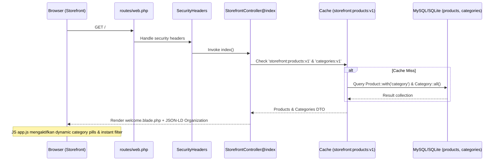
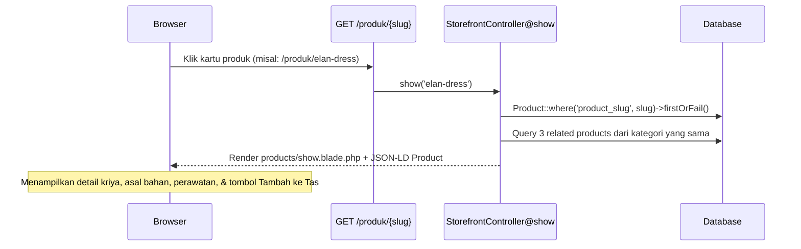
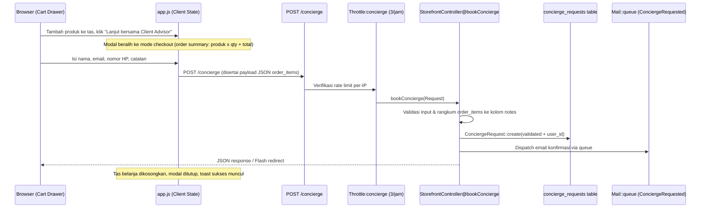
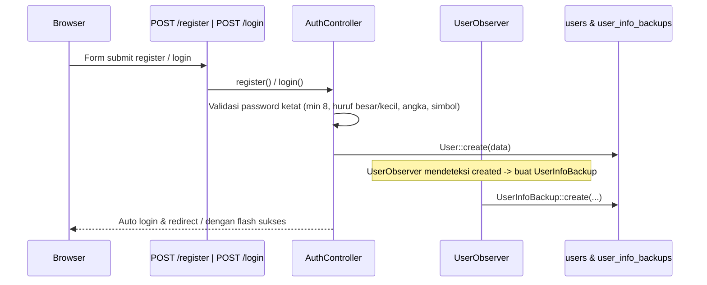
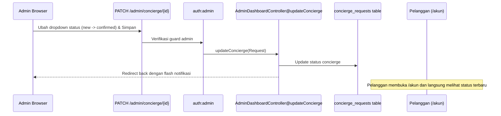

# Audit Integrasi Full-Stack (Integration Audit)

**Proyek:** ZAFIRA (`online-shop`)  
**Metodologi:** End-to-end tracing dari layer UI/Browser → Routing → Middleware → Request Validation → Controller → Business Logic → Model/Database → Response → Visual Result.  
**Tanggal:** 2026-10-10  

---

## 1. Alur 1: Penjelajahan Katalog & Filter Kategori Dinamis

- **Titik Putus / Risiko:** Cache invalidation harus selalu terpanggil saat admin memodifikasi produk atau kategori (`AdminCategoryController::flushStorefrontCache()`). Saat ini sudah terhubung dengan baik pada `AdminProductController` dan `AdminCategoryController`.
- **Status:** **Terintegrasi Penuh (Verified).**

---

## 2. Alur 2: Detail Produk & Transparansi Kriya (Heritage & Provenance)

- **Titik Putus / Risiko:** Jika slug tidak ditemukan di database, controller melempar `firstOrFail()` yang menghasilkan respon 404 standar.
- **Status:** **Terintegrasi Penuh (Verified).**

---

## 3. Alur 3: Tas Belanja & Checkout Pemesanan (Concierge Checkout)

- **Titik Putus / Kesenjangan Produk:**
  1. Data pesanan saat ini dikonversi menjadi teks sederhana di kolom `notes` pada tabel `concierge_requests` (`[Pesanan Checkout] - Robe Élan (1x)...`).
  2. Tidak ada entitas relasional `orders` dan `order_items` terpisah untuk perhitungan kuantitas stok atau faktur resmi.
  3. Pengiriman email bergantung pada adanya worker antrean (`php artisan queue:work`).
- **Status:** **Fungsional Parsial (Perlu peningkatan ke skema Order terstruktur).**

---

## 4. Alur 4: Otentikasi & Sinkronisasi Profil Pelanggan

- **Titik Putus / Risiko:** Isolasi multi-guard: saat pelanggan logout (`/logout`), controller secara cerdas mengecek `!Auth::guard('admin')->check()` agar sesi admin yang aktif tidak terputus di browser yang sama.
- **Status:** **Terintegrasi Penuh (Verified).**

---

## 5. Alur 5: Manajemen Admin & Pembaruan Status Transaksi

- **Titik Putus / Risiko:** Sinkronisasi status antara admin dan pelanggan terverifikasi bekerja dengan baik melalui relasi `user_id` atau pencocokan `email`.
- **Status:** **Terintegrasi Penuh (Verified).**
