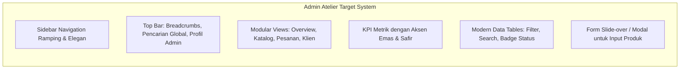

# Audit Antarmuka & Pengalaman Pengguna (UI/UX Audit)

**Proyek:** ZAFIRA (La Maison de Lumière — `online-shop`)  
**Fokus Evaluasi:** Sisi Pelanggan (Storefront) vs Sisi Pengelola (Admin Atelier)  
**Tanggal:** 2026-10-10  

---

## 1. Audit Storefront Pelanggan (Customer Experience)

### Aset Visual & Kekuatan yang Wajib Dipertahankan
1. **Identitas Tipografi Mewah:**
   - Kombinasi font editorial serif **Bodoni Moda** (untuk heading, kutipan editorial, dan angka harga elegan) dipadukan dengan sans-serif modern **Manrope** (untuk keterbacaan teks deskripsi dan label navigasi).
   - Skala tipografi memiliki hierarki yang sangat matang dan proporsional.
2. **Palet Warna Haute Couture:**
   - Warna utama terinspirasi batu mulia Safir: Biru Safir Gelap (`#17263f`), Emas Antik/Champagne (`#c7a665`), Linen Halus (`#f7f5f0`), dan Tinta Pekat (`#111827`).
   - Memberikan kesan rumah mode Paris papan atas (*luxury atelier*).
3. **Komponen Interaktif Responsif:**
   - **Cart Drawer:** Transisi halus dari sisi kanan, penghitungan subtotal real-time, kontrol kuantitas, input personalisasi monogram, dan tautan langsung ke halaman produk.
   - **Quick View Modal:** Memungkinkan eksplorasi detail bahan dan foto tanpa meninggalkan halaman beranda.
   - **Concierge Rendez-vous Modal:** Mengakomodasi konsultasi personal penata gaya sekaligus transisi mulus ke mode konfirmasi pesanan mewah.
4. **Performa & Aksesibilitas (A11y):**
   - Atribut gambar `width` dan `height` anti-CLS lengkap.
   - Pemanfaatan `loading="lazy"` untuk elemen di bawah lipatan dan `fetchpriority="high"` untuk hero banner.
   - Skip links (`#main-content`) dan ikon SVG dengan deskripsi aria.

---

## 2. Audit Panel Administrasi (Admin Atelier)

### Kondisi Aktual & Temuan Masalah Desain
1. **Tata Letak Monolitik Satu Halaman (Single-Page Monolith):**
   - Saat ini seluruh modul admin (Kategori, Produk, User, Audit Backup, Concierge, Subscriber, Password) ditumpuk dalam satu file panjang `resources/views/admin/dashboard.blade.php`.
   - Navigasi hanya mengandalkan anchor internal (`#panel-kategori`, `#panel-produk`, dll.) yang menyebabkan halaman sangat panjang dan melelahkan untuk di-scroll.
2. **Hierarki Visual & Kontras yang Belum Seimbang:**
   - Kartu metrik KPI (`.stat-card`) masih kaku dan sederhana (hanya kotak putih dengan border abu-abu tipis), tanpa aksen kemewahan atau indikator visual tren.
   - Formulir tambah produk disembunyikan di dalam tag `
` bawaan browser yang kurang intuitif bagi pengelola toko.
3. **Inkonsistensi Pola Interaksi:**
   - Pembaruan produk hanya menyediakan dropdown perpindahan kategori di tabel, sementara atribut produk lainnya (harga, warna, bahan) tidak memiliki antarmuka edit modal/halaman khusus.
   - Tabel data belum memiliki filter bertingkat, sorting dinamis, atau paginasi visual modern.
4. **Kesenjangan Estetika vs Storefront:**
   - Storefront memancarkan kemewahan kelas dunia, sementara panel admin saat ini terlihat seperti antarmuka internal minimalis tanpa identitas atelier yang selaras.

---

## 3. Rekomendasi Desain Target untuk Admin Atelier

1. **Sistem Layout Terpadu (Unified Admin Shell):**
   - Hadirkan sidebar ramping dengan ikon dan tipografi atelier yang selaras dengan tema ZAFIRA.
   - Header atas dengan breadcrumbs dinamis, status koneksi sistem, dan menu profil.
2. **Katalog Produk Profesional:**
   - Tabel produk yang menampilkan thumbnail gambar, badge edisi terbatas, harga terformat rapi, status kategori, dan tombol aksi (Edit Lengkap / Hapus).
   - Slide-over form (drawer) untuk menambah dan memperbarui detail kriya produk.
3. **Manajemen Pesanan & Status yang Jelas:**
   - Kartu pesanan dengan status badge berwarna konsisten (`new`: biru langit, `contacted`: kuning emas, `confirmed`: hijau emerald, `completed`: ungu royal, `cancelled`: merah lembut).
