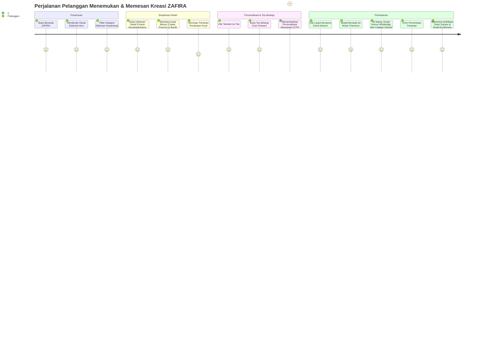
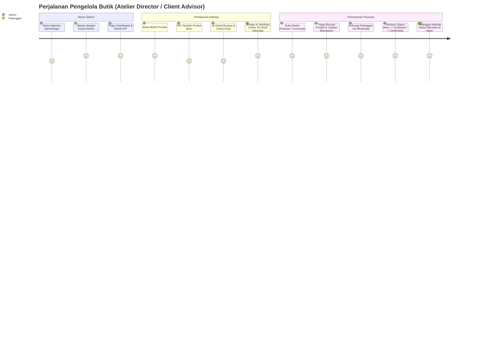
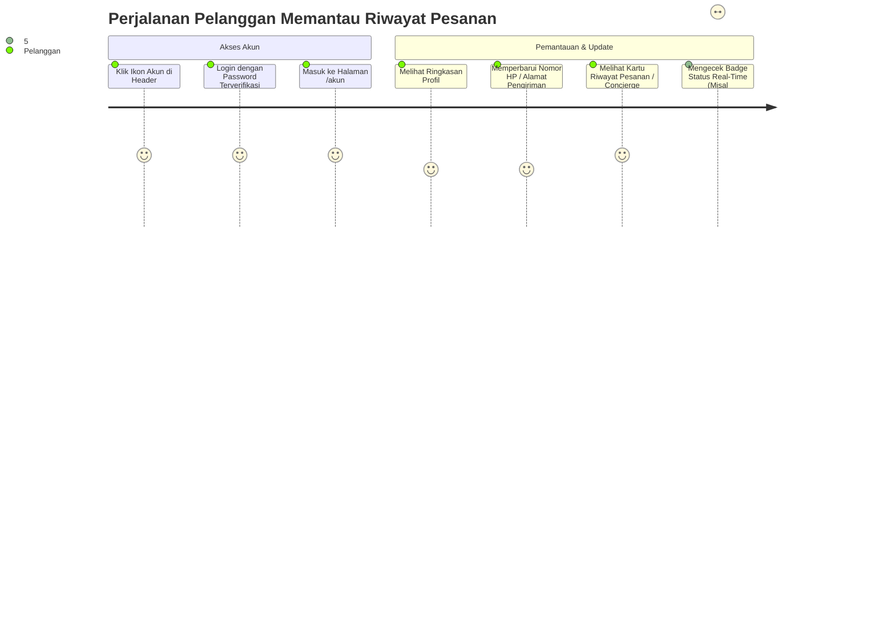

# Pemetaan Alur Pengguna (User Journeys)

**Proyek:** ZAFIRA (La Maison de Lumière — `online-shop`)  
**Tanggal:** 2026-10-10  

---

## 1. Journey 1: Eksplorasi Karya Adibusana & Pemesanan Monogram (Pelanggan)

---

## 2. Journey 2: Manajemen Katalog & Alur Status Pesanan (Admin Atelier)

---

## 3. Journey 3: Pemantauan Profil & Riwayat Pesanan (Pelanggan Terdaftar)

