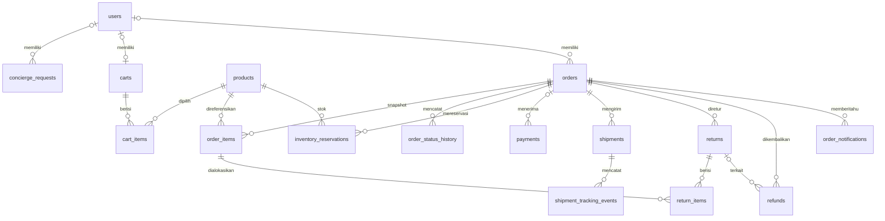
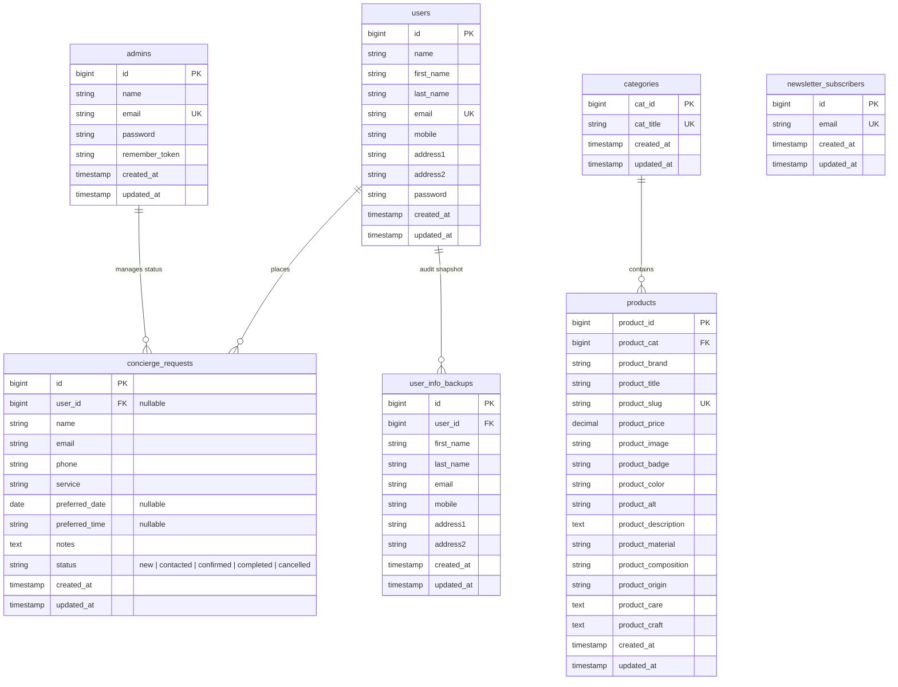

# Desain Database & Skema Terpadu (Database Design & ERD)

**Proyek:** ZAFIRA (La Maison de Lumière — `online-shop`)  
**Revisi:** 2026-10-21 — REM-20261021 DOC; DOC-03 / DATA-10

**Batas bukti:** skema menurut source migrasi, bukan hasil inspeksi database hidup. Status penerapan migrasi dan kompatibilitas engine saat ini **BELUM DIVERIFIKASI**. Target engine/collation 10 Oktober dipertahankan hanya dalam arsip.

## 1. Skema transaksi saat ini menurut source

Order, item, pembayaran, shipment, retur/refund, history dan reservasi **sudah memiliki implementasi**, bukan sekadar rencana post-MVP. Diagram ini adalah subset relasi transaksi; tidak mengklaim inventaris seluruh tabel auth/cache/queue. Rujukan kontrak: [REM](../04-implementation/REMEDIATION_REAL_WORLD_2026-10-21.md), [AC-REM-F02/F04/N03](../04-implementation/ACCEPTANCE_CRITERIA.md), [crosswalk bukti](../04-implementation/REQUIREMENT_TRACEABILITY.md), dan [TPS real-world](TPS_REAL_WORLD_TESTING_2026-10-21.md). Model volume TPS bukan ukuran storage/throughput dan delta bertanggalnya tidak membuktikan runtime terbaru.



Relasi pada diagram tidak menggantikan unique/FK di bawah. `carts.user_id` unik bila terisi; `shipments.order_id` **tidak unik** meskipun model `Order::shipment()` memakai `hasOne`. Inquiry tidak mempunyai FK otomatis ke order; email bukan relasi kepemilikan.

### 1.1 Kamus kontrak transaksi dan constraint

Semua path migrasi berikut relatif terhadap `database/migrations/`; baca urutan migrasi, bukan hanya file create awal.

| Tabel / kolom penting | Kontrak source saat ini | Migrasi sumber |
|---|---|---|
| `products` | `product_price DECIMAL(10,2)`; `product_image VARCHAR(255) NULL`, bukan 1000. Admin menerima IDR integral 0…99.999.999 (pecahan hanya `.0`/`.00`) dan string gambar ≤255 karakter. FK kategori restrict delete/cascade update. Validasi panjang bukan bukti URL eksternal valid. | `2026_09_07_034058_create_products_table.php`; validasi `app/Http/Controllers/AdminProductController.php` |
| `carts`, `cart_items` | User nullable/unik; token hash unik; pasangan cart/product unik; quantity unsigned integer. FK item→cart/product cascade delete. Tidak ada kolom size/monogram. Down menolak cart yang masih ada. | `2026_10_19_000002_create_carts_tables.php` |
| `orders` | `user_id NULL` dengan SET NULL saat user dihapus; snapshot kontak guest/alamat, status varchar, key/hash. Unique `(user_id,idempotency_key)` dan `(guest_scope_hash,idempotency_key)`; tracking token hash unik/nullable. Voucher nullable SET NULL. | `2026_10_12_000003_create_orders_table.php`; `2026_10_19_000001_add_guest_checkout_to_orders_table.php`; `2026_10_19_000003_protect_orders_from_user_delete.php` |
| Nominal order/item/payment | `orders.subtotal/discount/shipping_fee/total/tax`, `order_items.unit_price/subtotal`, `payments.amount`: **unsigned BIGINT**, IDR integral. Quantity unsigned integer. Item menyimpan judul/harga snapshot, tidak menyimpan monogram. | Migrasi orders di atas; `2026_10_12_000004_create_order_items_table.php`; `2026_10_19_000004_add_tax_and_shipping_breakdown_to_orders_table.php`; `2026_10_20_000003_create_payments_table.php` |
| `order_items`, history, reservasi | Item→order cascade, item→product restrict. `order_status_history`→order cascade; `admin_id` nullable **tanpa FK deklaratif**. `inventory_reservations`→order/product cascade; quantity/status/expiry dan indeks tersedia. | `2026_10_12_000004_create_order_items_table.php`; `2026_10_20_000001_create_order_status_history_table.php`; `2026_10_20_000002_create_inventory_reservations_table.php` |
| `payments` | Order nullable SET NULL; dedup unique `(provider,provider_transaction_id,event_status)` dan payload JSON. Unique event bukan jaminan hanya satu event progres pembayaran; invariant ditangani service. | `2026_10_20_000003_create_payments_table.php` |
| `shipments`, `shipment_tracking_events` | Shipment→order cascade; courier/tracking nullable; indeks order/status, **tanpa unique order_id**. Event→shipment cascade. | `2026_10_20_000002_create_shipments_table.php` |
| `returns`, `return_items`, `refunds` | Return/refund→order cascade; user keduanya nullable SET NULL. Return item→return/order_item cascade; `return_items.product_id` unsigned BIGINT **tanpa FK**. Refund→return nullable SET NULL. Return/refund number unik; status domain terpisah dari order. | `2026_10_20_000003_create_returns_tables.php`; `2026_10_20_000004_create_refunds_table.php`; `2026_10_20_000005_protect_returns_and_refunds_from_user_delete.php` |
| `order_notifications` | FK order cascade; unique `(order_id,status,channel)` untuk idempotensi notifikasi. Keberadaan record bukan bukti delivery mail. | `2026_10_20_000005_create_order_notifications_table.php` |

**Batas nominal:** unsigned INTEGER lama maksimal 4.294.967.295; unsigned BIGINT MySQL/MariaDB memiliki kapasitas lebih besar, tetapi bukan janji aplikasi mendukung seluruh rentangnya. Aritmetika PHP tetap dibatasi integer platform; SQLite tidak membuktikan enforcement unsigned/rentang maupun locking InnoDB. Snapshot transaksi harus konsisten dan diuji dengan batas/overflow; harga katalog tetap DECIMAL, tidak ikut diperlebar.

### 1.2 Migrasi remediasi dan provenance alokasi retur

- **`2026_10_21_000050_widen_return_refund_money_columns.php`:** memperlebar `returns.requested_refund_amount` (default 0), `return_items.unit_price/subtotal`, dan `refunds.amount` menjadi unsigned BIGINT. `down()` memeriksa **semua kolom di semua tabel sebelum DDL pertama**, menolak nilai >4.294.967.295. Writers harus dihentikan; preflight bukan transaksi DDL atomik lintas tabel pada MySQL.
- **`2026_10_21_000060_add_return_allocation_provenance.php`:** menambah `return_items.allocation_version VARCHAR(32) NULL`, `allocation_quantity_before UNSIGNED INTEGER NULL`, dan `allocation_amount_before UNSIGNED BIGINT NULL`. **Tidak ada backfill.** Null berarti legacy/tidak diketahui, bukan provenance yang tervalidasi.
- `OrderReturnController::store` menulis versi `ReturnAllocation::VERSION` (`net-balance-v2`) beserta kuantitas/nominal saldo sebelum alokasi. `ReturnAllocation` menghitung dari snapshot bersih `subtotal−discount+tax`; ongkir tidak otomatis direfund. Provenance di sini adalah **jejak perhitungan uang**, bukan asal bahan/keaslian produk. Data legacy all-null hanya dapat diproses bila memenuhi batas legacy; data parsial/tidak konsisten wajib rekonsiliasi, tidak boleh “dipercaya” melalui backfill tebakan.
- `000060::down()` menolak bila **salah satu** dari tiga kolom provenance memiliki nilai non-null, sebelum drop kolom. Rollback nullable user pada order/return/refund juga harus memenuhi preflight sumbernya. Jangan menjalankan SQL arsip di bawah sebagai jalan pintas migrasi/rollback.
- Tes sumber: `tests/Feature/DataRemediationTest.php` (pelebaran, batas uint32, preflight semua tabel), `tests/Feature/TransactionRemediationTest.php` (saldo retur dan penolakan rollback provenance). **NOT RUN / PENDING REVIEW** untuk source terbaru; tidak ada migrasi/DB dijalankan dalam revisi dokumentasi ini.

---

## 2. Arsip desain 10 Oktober 2026 — tersupersesi, bukan skema aktif

**Catatan historis:** target engine saat itu MariaDB 10.4+ / MySQL 8.0+ / SQLite 3 (testing), charset `utf8mb4`, collation `utf8mb4_unicode_ci`; bukan hasil verifikasi konfigurasi kini. ERD/kamus/SQL berikut dipertahankan sebagai rekam desain awal. Termasuk relasi admin konseptual, ukuran gambar 1000, serta order “masa depan”, isinya **tidak boleh dipakai sebagai kontrak atau panduan eksekusi saat ini**. Rujuk bagian 1 dan file migrasi.

### 2.1 ERD historis



---

### 2.2 Kamus data historis — bukan kontrak aktif

### 1. Tabel `products`
| Kolom | Tipe Data | Nullable | Keterangan & Constraint |
|---|---|---|---|
| `product_id` | `BIGINT UNSIGNED` | Tidak | Primary Key, Auto Increment |
| `product_cat` | `BIGINT UNSIGNED` | Tidak | Foreign Key ke `categories.cat_id` (RESTRICT on delete, CASCADE on update) |
| `product_brand` | `VARCHAR(255)` | Tidak | Default 'ZAFIRA' |
| `product_title` | `VARCHAR(255)` | Tidak | Nama kreasi busana |
| `product_slug` | `VARCHAR(255)` | Ya | Unique index, URL slug ramah SEO |
| `product_price` | `DECIMAL(10,2)` | Tidak | Nilai harga dalam IDR |
| `product_image` | `VARCHAR(1000)` | Ya | URL gambar utama resolusi tinggi |
| `product_badge` | `VARCHAR(50)` | Ya | Label penanda (cth: 'Eksklusif', 'Warisan Nusantara', 'Signature') |
| `product_color` | `VARCHAR(50)` | Ya | Nama varian warna kreasi |
| `product_alt` | `VARCHAR(255)` | Ya | Deskripsi alt foto untuk aksesibilitas & SEO |
| `product_description` | `TEXT` | Ya | Narasi puitis editorial kreasi |
| `product_material` | `VARCHAR(255)` | Ya | Jenis bahan utama (cth: 'Sutra crepe de chine') |
| `product_composition` | `VARCHAR(500)` | Ya | Komposisi serat terperinci |
| `product_origin` | `VARCHAR(255)` | Ya | Provenance kriya (cth: 'Kain: Lyon · Jahit: Jakarta') |
| `product_care` | `TEXT` | Ya | Panduan perawatan spesifik busana adibusana |
| `product_craft` | `TEXT` | Ya | Detail pengerjaan tangan (jam kerja, teknik jahitan) |
| `created_at` / `updated_at` | `TIMESTAMP` | Ya | Timestamp standar Eloquent |

### 2. Tabel `categories`
| Kolom | Tipe Data | Nullable | Keterangan & Constraint |
|---|---|---|---|
| `cat_id` | `BIGINT UNSIGNED` | Tidak | Primary Key, Auto Increment |
| `cat_title` | `VARCHAR(255)` | Tidak | Unique index, nama kategori koleksi |
| `created_at` / `updated_at` | `TIMESTAMP` | Ya | Timestamp standar Eloquent |

### 3. Tabel `concierge_requests`
| Kolom | Tipe Data | Nullable | Keterangan & Constraint |
|---|---|---|---|
| `id` | `BIGINT UNSIGNED` | Tidak | Primary Key, Auto Increment |
| `user_id` | `BIGINT UNSIGNED` | Ya | Foreign Key ke `users.id` (SET NULL on delete) |
| `name` | `VARCHAR(255)` | Tidak | Nama pemesan / klien |
| `email` | `VARCHAR(255)` | Tidak | Email klien (dinormalisasi ke lowercase) |
| `phone` | `VARCHAR(30)` | Tidak | Nomor kontak / WhatsApp |
| `service` | `VARCHAR(255)` | Tidak | Layanan: private-styling, virtual-consultation, gifting, atelier |
| `preferred_date` | `DATE` | Ya | Tanggal janji temu (opsional untuk pesanan murni) |
| `preferred_time` | `VARCHAR(20)` | Ya | Waktu janji temu (opsional) |
| `notes` | `TEXT` | Ya | Catatan khusus klien atau ringkasan pesanan checkout |
| `status` | `VARCHAR(255)` | Tidak | Status: `new`, `contacted`, `confirmed`, `completed`, `cancelled` (default 'new') |
| `created_at` / `updated_at` | `TIMESTAMP` | Ya | Timestamp standar Eloquent |

---

### 2.3 Usulan SQL post-MVP historis — jangan dieksekusi

**Tersupersesi oleh migrasi yang dirangkum pada bagian 1.** Nama `order_number`, `total_amount`, `payment_status`, tipe nominal, dan kolom `monogram` pada usulan ini bukan representasi tabel order saat ini. Berikut rekam usulan awal, bukan migrasi yang harus diterapkan:

> Usulan 10 Oktober: skema transaksi formal kelak diperluas tanpa mematahkan data concierge.

```sql
-- Skema Tabel Transaksi E-Commerce Formal Masa Depan:
CREATE TABLE `orders` (
    `id` BIGINT UNSIGNED AUTO_INCREMENT PRIMARY KEY,
    `order_number` VARCHAR(50) NOT NULL UNIQUE,
    `user_id` BIGINT UNSIGNED NULL,
    `total_amount` DECIMAL(12,2) NOT NULL,
    `status` ENUM('pending', 'paid', 'processing', 'shipped', 'completed', 'cancelled') NOT NULL DEFAULT 'pending',
    `payment_method` VARCHAR(50) NULL,
    `payment_status` VARCHAR(50) NOT NULL DEFAULT 'unpaid',
    `created_at` TIMESTAMP NULL,
    `updated_at` TIMESTAMP NULL,
    FOREIGN KEY (`user_id`) REFERENCES `users`(`id`) ON DELETE SET NULL
);

CREATE TABLE `order_items` (
    `id` BIGINT UNSIGNED AUTO_INCREMENT PRIMARY KEY,
    `order_id` BIGINT UNSIGNED NOT NULL,
    `product_id` BIGINT UNSIGNED NOT NULL,
    `product_title` VARCHAR(255) NOT NULL,
    `product_price` DECIMAL(10,2) NOT NULL,
    `quantity` INT UNSIGNED NOT NULL DEFAULT 1,
    `monogram` VARCHAR(10) NULL,
    `subtotal` DECIMAL(12,2) NOT NULL,
    FOREIGN KEY (`order_id`) REFERENCES `orders`(`id`) ON DELETE CASCADE,
    FOREIGN KEY (`product_id`) REFERENCES `products`(`product_id`) ON DELETE RESTRICT
);
```
