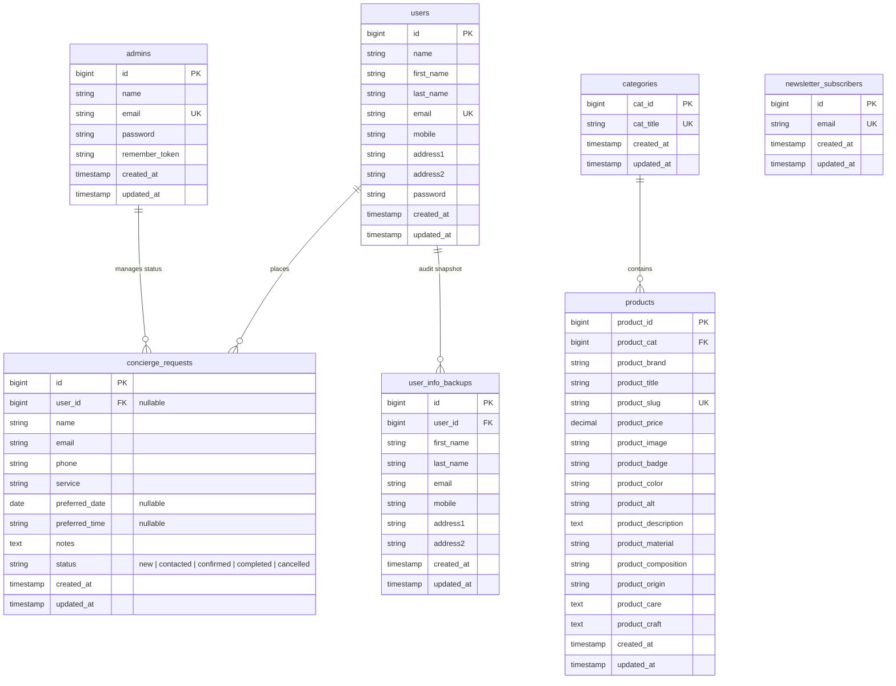

# Desain Database & Skema Terpadu (Database Design & ERD)

**Proyek:** ZAFIRA (La Maison de Lumière — `online-shop`)  
**Engine:** MariaDB 10.4+ / MySQL 8.0+ / SQLite 3 (Testing)  
**Karakter Set:** `utf8mb4` dengan Collation `utf8mb4_unicode_ci`  
**Tanggal:** 2026-10-10  

---

## 1. Entity Relationship Diagram (ERD)



---

## 2. Kamus Data Rinci (Data Dictionary)

### 1. Tabel `products`
| Kolom | Tipe Data | Nullable | Keterangan & Constraint |
|---|---|---|---|
| `product_id` | `BIGINT UNSIGNED` | Tidak | Primary Key, Auto Increment |
| `product_cat` | `BIGINT UNSIGNED` | Tidak | Foreign Key ke `categories.cat_id` (RESTRICT on delete, CASCADE on update) |
| `product_brand` | `VARCHAR(255)` | Tidak | Default 'ZAFIRA' |
| `product_title` | `VARCHAR(255)` | Tidak | Nama kreasi busana |
| `product_slug` | `VARCHAR(255)` | Ya | Unique index, URL slug ramah SEO |
| `product_price` | `DECIMAL(10,2)` | Tidak | Nilai harga dalam IDR |
| `product_image` | `VARCHAR(1000)` | Ya | URL gambar utama resolusi tinggi |
| `product_badge` | `VARCHAR(50)` | Ya | Label penanda (cth: 'Eksklusif', 'Warisan Nusantara', 'Signature') |
| `product_color` | `VARCHAR(50)` | Ya | Nama varian warna kreasi |
| `product_alt` | `VARCHAR(255)` | Ya | Deskripsi alt foto untuk aksesibilitas & SEO |
| `product_description` | `TEXT` | Ya | Narasi puitis editorial kreasi |
| `product_material` | `VARCHAR(255)` | Ya | Jenis bahan utama (cth: 'Sutra crepe de chine') |
| `product_composition` | `VARCHAR(500)` | Ya | Komposisi serat terperinci |
| `product_origin` | `VARCHAR(255)` | Ya | Provenance kriya (cth: 'Kain: Lyon · Jahit: Jakarta') |
| `product_care` | `TEXT` | Ya | Panduan perawatan spesifik busana adibusana |
| `product_craft` | `TEXT` | Ya | Detail pengerjaan tangan (jam kerja, teknik jahitan) |
| `created_at` / `updated_at` | `TIMESTAMP` | Ya | Timestamp standar Eloquent |

### 2. Tabel `categories`
| Kolom | Tipe Data | Nullable | Keterangan & Constraint |
|---|---|---|---|
| `cat_id` | `BIGINT UNSIGNED` | Tidak | Primary Key, Auto Increment |
| `cat_title` | `VARCHAR(255)` | Tidak | Unique index, nama kategori koleksi |
| `created_at` / `updated_at` | `TIMESTAMP` | Ya | Timestamp standar Eloquent |

### 3. Tabel `concierge_requests`
| Kolom | Tipe Data | Nullable | Keterangan & Constraint |
|---|---|---|---|
| `id` | `BIGINT UNSIGNED` | Tidak | Primary Key, Auto Increment |
| `user_id` | `BIGINT UNSIGNED` | Ya | Foreign Key ke `users.id` (SET NULL on delete) |
| `name` | `VARCHAR(255)` | Tidak | Nama pemesan / klien |
| `email` | `VARCHAR(255)` | Tidak | Email klien (dinormalisasi ke lowercase) |
| `phone` | `VARCHAR(30)` | Tidak | Nomor kontak / WhatsApp |
| `service` | `VARCHAR(255)` | Tidak | Layanan: private-styling, virtual-consultation, gifting, atelier |
| `preferred_date` | `DATE` | Ya | Tanggal janji temu (opsional untuk pesanan murni) |
| `preferred_time` | `VARCHAR(20)` | Ya | Waktu janji temu (opsional) |
| `notes` | `TEXT` | Ya | Catatan khusus klien atau ringkasan pesanan checkout |
| `status` | `VARCHAR(255)` | Tidak | Status: `new`, `contacted`, `confirmed`, `completed`, `cancelled` (default 'new') |
| `created_at` / `updated_at` | `TIMESTAMP` | Ya | Timestamp standar Eloquent |

---

## 3. Rencana Evolusi Menuju Domain E-Commerce Formal (Post-MVP Extension)

Untuk pengembangan lanjutan di mana sistem pembayaran kartu kredit otomatis diaktifkan, skema dapat diperluas dengan tabel relasional berikut tanpa mematahkan data concierge yang ada:

```sql
-- Skema Tabel Transaksi E-Commerce Formal Masa Depan:
CREATE TABLE `orders` (
    `id` BIGINT UNSIGNED AUTO_INCREMENT PRIMARY KEY,
    `order_number` VARCHAR(50) NOT NULL UNIQUE,
    `user_id` BIGINT UNSIGNED NULL,
    `total_amount` DECIMAL(12,2) NOT NULL,
    `status` ENUM('pending', 'paid', 'processing', 'shipped', 'completed', 'cancelled') NOT NULL DEFAULT 'pending',
    `payment_method` VARCHAR(50) NULL,
    `payment_status` VARCHAR(50) NOT NULL DEFAULT 'unpaid',
    `created_at` TIMESTAMP NULL,
    `updated_at` TIMESTAMP NULL,
    FOREIGN KEY (`user_id`) REFERENCES `users`(`id`) ON DELETE SET NULL
);

CREATE TABLE `order_items` (
    `id` BIGINT UNSIGNED AUTO_INCREMENT PRIMARY KEY,
    `order_id` BIGINT UNSIGNED NOT NULL,
    `product_id` BIGINT UNSIGNED NOT NULL,
    `product_title` VARCHAR(255) NOT NULL,
    `product_price` DECIMAL(10,2) NOT NULL,
    `quantity` INT UNSIGNED NOT NULL DEFAULT 1,
    `monogram` VARCHAR(10) NULL,
    `subtotal` DECIMAL(12,2) NOT NULL,
    FOREIGN KEY (`order_id`) REFERENCES `orders`(`id`) ON DELETE CASCADE,
    FOREIGN KEY (`product_id`) REFERENCES `products`(`product_id`) ON DELETE RESTRICT
);
```
