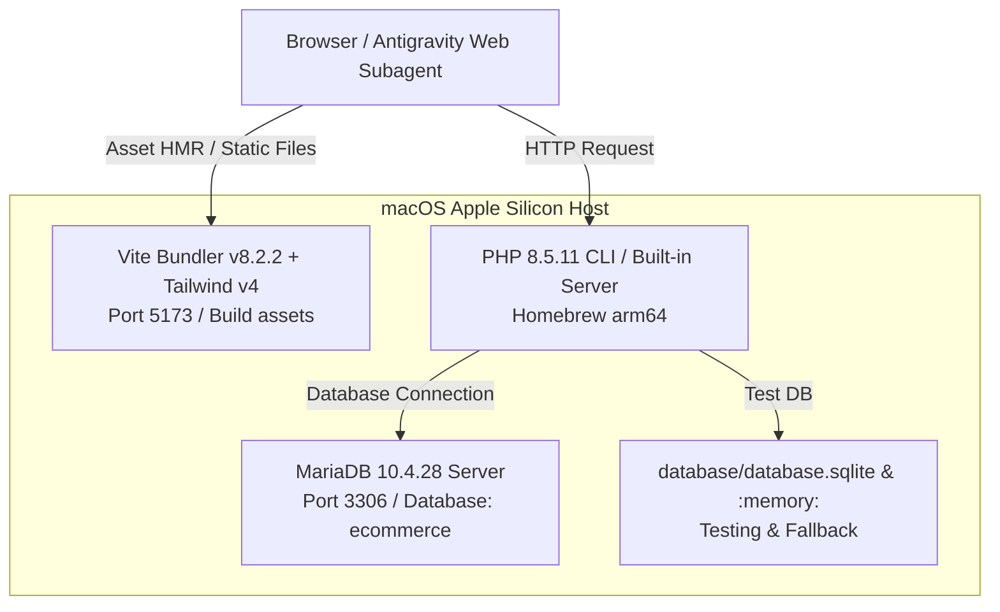

# Panduan Lingkungan & Runtime macOS (Environment & Runtime)

**Proyek:** ZAFIRA (La Maison de Lumière — `online-shop`)  
**Target:** macOS / MacBook (Apple Silicon arm64)  
**Dokumen:** Arsitektur Runtime & Standar Pengoperasian Lokal  

---

## 1. Topologi Runtime Lokal



---

## 2. Konfigurasi Lingkungan (.env)

Aplikasi telah dikonfigurasikan untuk berjalan secara mulus di lingkungan macOS:
- `APP_NAME=ZAFIRA`
- `APP_ENV=local`
- `APP_DEBUG=true`
- `APP_URL=http://localhost:8000`
- `DB_CONNECTION=mysql`
- `DB_HOST=127.0.0.1`
- `DB_PORT=3306`
- `DB_DATABASE=ecommerce`
- `DB_USERNAME=root`
- `DB_PASSWORD=`
- `SESSION_DRIVER=database` (atau `file` / `array` saat pengujian)
- `QUEUE_CONNECTION=database`
- `CACHE_STORE=database`

*Catatan Keamanan:* Kredensial produksi tidak boleh disimpan di `.env` pengembangan lokal.

---

## 3. Perintah Standar Pengoperasian

### 1. Kompilasi Aset Frontend (Vite)
```bash
# Build mode produksi
npm run build

# Mode development dengan Hot Module Replacement (HMR)
npm run dev
```

### 2. Menjalankan Server Web Lokal
```bash
# Menjalankan server built-in Laravel
php artisan serve --port=8000
```

### 3. Menjalankan Queue Worker (Untuk Pengiriman Email)
```bash
php artisan queue:work --tries=3
```

### 4. Menjalankan Test Suite Otomatis
```bash
# Menjalankan seluruh test (in-memory SQLite)
php artisan test
```

### 5. Memeriksa Standar Gaya Kode (Pint)
```bash
# Uji kepatuhan formatting
vendor/bin/pint --test

# Memperbaiki formatting otomatis jika ada penyimpangan
vendor/bin/pint
```
