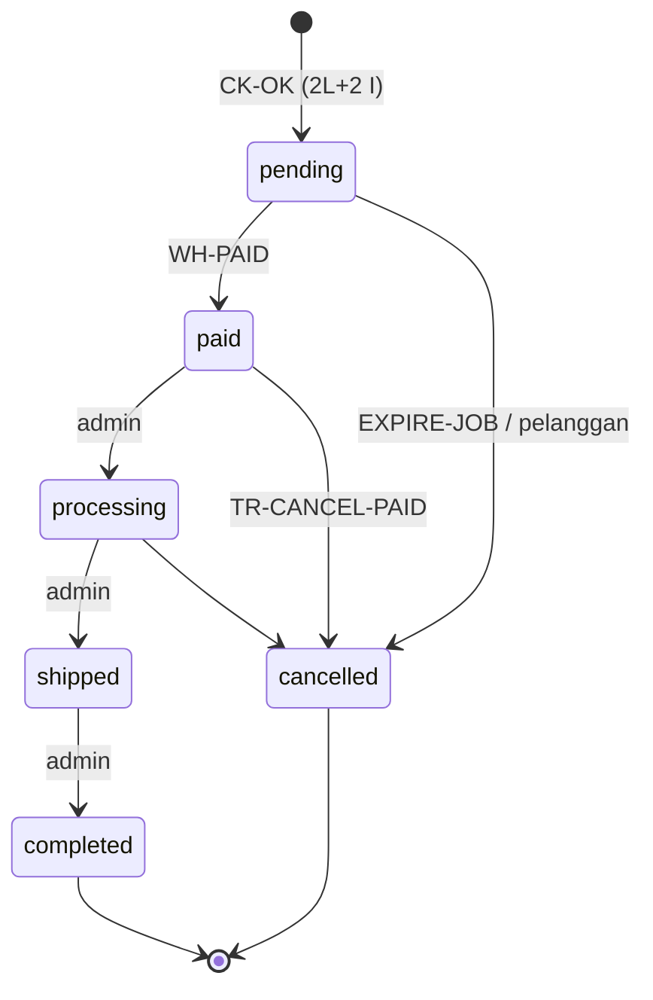

# Pengujian TPS Dunia Nyata: Pendataan Transaksi, Volume, Kualitas, dan Kontrak Metrik Admin

**ID kerja:** REM-20261021 · **Requirement induk:** FR-REM-007, NFR-REM-001…006 (`docs/04-implementation/REMEDIATION_REAL_WORLD_2026-10-21.md`)
**Baseline historis — bukan status working tree akhir:** 21 Oktober 2026 (kalkulasi takeover awal 12:18:08 UTC) · **Commit sumber awal:** `041ed083a1be330d97d4f335cda8555670045cdd`
**Kondisi historis working tree saat pembacaan awal:** dokumen audit/remediasi tidak terlacak dan lima berkas uji RED baru (`tests/Feature/{Backup,Data,Operations,Transaction}RemediationTest.php`, `tests/ops-remediation.test.mjs`) belum terlacak. Tidak ada perubahan pada `app/`, `routes/`, `config/`, `database/`. Agent lain dapat sedang mengubah kode; nomor baris di bawah mengacu pada pembacaan sesi ini.
**Takeover:** penulis awal sesi `d04a9029-6c21-4096-954c-85e45a3515c0` berhenti karena kredit model habis, dikonfirmasi pengguna. Isi parsial dipertahankan dan dilengkapi; status working tree pada paragraf sebelumnya adalah catatan penulis awal, bukan snapshot terbaru. Pembacaan takeover menemukan perubahan milik lane lain pada ledger/indeks dan tambahan tes belum terlacak; semuanya tidak disentuh.
**Status otoritatif terkini — finalisasi 21 Oktober 2026:** implementasi MSI minimum dan remediasi TXN sudah ada pada source; targeted test, full-suite final dan approval source independen dilaporkan/didukung bukti di **§13.5**. §13.4 adalah snapshot hasil sebelum run R7/final. Reviewer TPS/MSI `baba615a-5f4d-4965-82f6-70194d773b5d` menyetujui source delta; reviewer TXN `88fc481b-b7cd-4d36-a1e2-d41c567d49ca` menyetujui source menurut handoff pengguna. Ini menggantikan status awal “kontrak belum diimplementasikan”, “review belum ada”, dan “R2 aktif” sebagai status sekarang. §5–6 dan rekomendasi awal §7/13 tetap historis kecuali dinyatakan lain. **Main menerima koreksi dokumentasi dan bukti final pada §13.5; gate beban/throughput nyata tetap terbuka. Bukan persetujuan produksi, bukan semua gate GREEN.**
**Hubungan dengan dokumen lain:** `TPS_VOLUME_AND_QUALITY_ANALYSIS.md` dan `COMPREHENSIVE_AUDIT_2026-10-21.md` tetap dokumen historis dan tidak diubah. Dokumen ini memperluasnya (bagian 5.1 mencatat apa yang ditambahkan).

## 1. Ringkasan dan status bukti

Label bukti (sesuai `ENGINEERING_EXCELLENCE_PROTOCOL.md` §5): **[F]** fakta dari kode/dokumen primer, **[I]** inferensi, **[A]** asumsi eksplisit, **[U]** belum tersedia / `TIDAK TERBUKTI`, **[R]** rekomendasi terbuka.

1. **[F]** "TPS" di repo ini adalah *Transaction Processing System* (lapisan operasional pada `MANAGEMENT_INFORMATION_SYSTEM_AND_ENTERPRISE_ARCHITECTURE.md` §2.A), bukan angka *transactions per second*. Dokumen ini memisahkan lima satuan: order/detik, pengiriman webhook/detik, commit DB/detik, baris-tulis (INSERT/UPDATE/DELETE)/detik, dan byte. Koefisien beban logis dapat diturunkan dari kode; seluruh laju aktual, jumlah commit fisik, dan byte tetap harus diukur. Angka per detik di sini hanya proyeksi dari input order/hari.
2. **[F]** Dokumen lama menghitung **INSERT** saja (17 baris/order untuk jalur lengkap, L=2). Dokumen ini menambahkan **UPDATE** dan **DELETE**, cabang non-lengkap (kedaluwarsa, bayar-lalu-batal), baris antrean, dan biaya baca-yang-menulis. Untuk jalur lengkap L=2 dengan antrean database: **35 baris-tulis bisnis** (17 INSERT, 16 UPDATE, 2 DELETE) ditambah **9** pada tabel `jobs` = **44** (bagian 5.2, 6.2).
3. **[F]** Bukan hanya transaksi bisnis yang menulis. `CartStore::locked()` dipakai oleh `GET /cart`, `/checkout/quote`, dan login; untuk pengguna login ia mengunci baris `users` dan `carts` (`FOR UPDATE`) serta menjalankan `insertOrIgnore` pada `carts` (`app/Services/CartStore.php:29-33`). Jadi *endpoint baca* menulis/mengunci. Setiap request web juga menulis `sessions`, dan setiap request ber-throttle menulis `cache` bila driver-nya database (default konfigurasi, §5.5).
4. **[F]+[A], baseline historis:** Retry berasal dari tiga sumber berbeda dan tidak boleh dicampur dengan "order bisnis": (a) retry internal checkout ≤ 4 percobaan (`CheckoutService.php:196-226`), (b) retry webhook oleh Midtrans menurut kode status balasan kita (dokumen resmi Midtrans, bagian 5.3), (c) replay dead letter terjadwal (`routes/console.php:57`). Pengiriman webhook, event pembayaran, dan order adalah tiga hitungan yang berbeda. Batas4 exponential ini milik service langsung/baseline, **bukan outer HTTP kini** (3 percobaan linear; §13.3–13.4).
5. **[F]+[A]+[I]** Penurunan baru dari bukti: `throttle:60,1` pada `/webhooks/midtrans` (`routes/web.php:124`) berarti, jika semua pengiriman datang dari satu kunci limiter, **ambang aman ≈ 86.400/(K×P) order/hari**; dengan asumsi puncak K=10 dan P=1–2 itu **8.640–4.320 order/hari**, di bawah skenario 10.000 order/hari. Respons 429 termasuk kategori "Other" pada tabel retry Midtrans (lima kali retry). Ini inferensi dari asumsi, bukan temuan kegagalan nyata (bagian 6.5).
6. **[U]** Tetap `TIDAK TERBUKTI`: throughput maksimum, latensi, uptime, SLA/SLO aktual, driver cache/queue/session produksi, engine produksi, ukuran byte, waktu pulih, dan kegunaan antarmuka. Body plaintext masuk dibatasi 16.384 byte (`PaymentWebhookService::process`). Ini **bukan** ukuran kolom/baris tersimpan: `PaymentDeadLetter` memakai cast `encrypted`, sehingga overhead ciphertext/enkripsi dan storage belum dihitung.
7. **[R], rekomendasi baseline yang kini sudah memiliki implementasi minimum:** Kontrak metrik operasional admin kecil `ops-metrics.v1` (bagian 7) memakai hanya tabel yang ada, tanpa klaim WIP, manufaktur, DSS, atau EIS yang hidup. Rekomendasi awal untuk `main` ada di bagian13; source dan bukti aktual mengacu §13.4, bukan klaim implementasi masih kosong.

## 2. Lingkup, metode, dan batas

- **Dibaca:** `AGENTS.md`, `AGENT_OPERATING_MODEL.md`, `ENGINEERING_EXCELLENCE_PROTOCOL.md`, `REMEDIATION_REAL_WORLD_2026-10-21.md`, `COMPREHENSIVE_AUDIT_2026-10-21.md` (§1–6 dan §7–13), `TPS_VOLUME_AND_QUALITY_ANALYSIS.md`, `MANAGEMENT_INFORMATION_SYSTEM_AND_ENTERPRISE_ARCHITECTURE.md`, `SCHEDULED_TASKS_AND_ENV_PARITY.md`; kode: `CheckoutService`, `CartStore`, `PaymentWebhookService`, `OrderNotificationDispatcher`, `RefundService`, `ReleaseExpiredReservations`, `AuthEventRecorder`, `UserObserver`, controller order/guest/return/admin-order/health, `routes/web.php`, `routes/console.php`, `config/{queue,cache,session,backup,features}.php`, migrasi tabel transaksi, dan sumber Laravel 13.36.0 di `vendor/` untuk perilaku driver database (rank sumber 1).
- **Tidak dilakukan:** tidak membaca `.env*`; tidak menyentuh database, runtime aplikasi, atau jaringan selain `fetch` ke sumber publik (bagian 12); tidak menjalankan benchmark, browser, migrasi, atau restore; tidak commit; tidak mengubah ledger, `docs/README.md`, atau berkas lain.
- **Perintah lokal yang dijalankan** (semua baca-saja atau kalkulasi tanpa DB): `git rev-parse HEAD`, `git status --short`, `grep`/`sed` pada sumber, dan dua skrip `python3` inline untuk kalkulasi bagian 6 — keduanya `EXIT=0` (terakhir 2026-10-21T12:10:13Z). Skrip menyertakan `assert` silang untuk rumus tertutup (L=1,2,3) dan memastikan 17 baris/order sama dengan dokumen lama.
- **Skill dipakai:** `documentation-and-adrs` (struktur, evidence, keputusan vs konteks) dan `domain-modeling` (bagian 4: istilah dipertajam, kontradiksi dicatat). ADR dan `GLOSSARY.md` **tidak** dibuat karena scope tulis hanya satu berkas; kandidat ADR dicatat di bagian 13. Skill browser/benchmark tidak dijalankan karena tidak ada runtime. Skill media/mobile/animasi dilewati karena tidak relevan.

## 3. Pemetaan requirement

ID `FR-REM-*`/`NFR-REM-*` dari dokumen remediasi. ID **USULAN** berprefiks `TPSRW` belum disetujui dan belum ada di `REQUIREMENT_TRACEABILITY.md`; jangan dianggap requirement resmi sampai didaftarkan.

| Permintaan pengguna | Requirement terkait | ID usulan | Bagian | Uji (bagian 9) | Status |
|---|---|---|---|---|---|
| Fitur transaksi, pendataan | FR-REM-007 | FR-TPSRW-001 inventori jalur data dan rumus baris | 5 | TST-01 | Dianalisis; uji hitung-pernyataan belum ditulis |
| Pembuatan data per waktu/volume | FR-REM-007, NFR-REM-001 | NFR-TPSRW-001 proyeksi dapat dihitung ulang, byte ditandai belum diukur | 6 | TST-07 | Tabel dihitung; byte `[U]` |
| Performance | NFR-REM-001 | NFR-TPSRW-002 baseline p50/p95/p99 + USE | 8, 9 | TST-03, TST-05 | `[U]` belum diukur |
| Continuous availability | NFR-REM-002 | NFR-TPSRW-003 gate kegagalan worker/scheduler/provider/pulih | 8, 9 | TST-04, TST-06 | `[U]` |
| Data integrity | NFR-REM-003 | NFR-TPSRW-004 invarian + metrik integritas | 7, 9 | TST-02, TST-01 | Kontrak diusulkan; uji `[U]` |
| Ease of use (HCI) | NFR-REM-004 | NFR-TPSRW-005 panel admin dapat dipindai, status tidak hanya warna | 7.5, 9 | TST-08 | `[U]` browser/pembaca layar tidak dijalankan |
| Modular growth | NFR-REM-005 | NFR-TPSRW-006 metrik lewat service terpisah, flag fail-closed | 13 | TST-09 | Rekomendasi |
| Controlled processing | NFR-REM-006 | NFR-TPSRW-007 backlog/umur/rekonsiliasi terlihat, otorisasi `view-reports` | 7 | TST-09, TST-04 | Rekomendasi |
| Admin selaras MSI & HCI | FR-REM-005, FR-REM-007 | FR-TPSRW-002 ringkasan operasional `ops-metrics.v1` | 7 | TST-08, TST-09 | Rekomendasi |
| Proposal NFR-TPS-001…007 lama | (dokumen lama §8) | — | 9 | pemetaan di tabel TST | Dipertahankan, dipetakan ke TST |

## 4. Istilah domain (hasil `domain-modeling`)

Istilah ini mempertajam bahasa bersama (lensa Evans). Mereka bukan isi `GLOSSARY.md`.

| Istilah kerja | Definisi | Jangan dicampur dengan |
|---|---|---|
| **TPS (sistem)** | Lapisan pemrosesan transaksi operasional | "TPS" sebagai laju. Pakai satuan eksplisit |
| **Order berhasil** | Satu baris `orders` baru dari checkout (`wasRecentlyCreated`) | Percobaan checkout, replay idempotensi |
| **Percobaan checkout** | Satu request HTTP `POST /checkout` apa pun hasilnya | Order berhasil |
| **Line (L)** | Produk berbeda dalam cart/order, bukan jumlah unit (maks 99 unit/line) | Quantity |
| **Pengiriman webhook (W)** | Satu HTTP POST dari Midtrans ke `/webhooks/midtrans` | Event pembayaran |
| **Event pembayaran (P)** | Satu baris `payments` unik per (provider, transaction_id, event_status), semua status | Order dibayar (≤1 baris dengan `outcome='paid'`) |
| **Slot notifikasi (N)** | Satu baris `order_notifications` per (order, status, channel) | Email sampai ke inbox. `dispatched_at` hanya bukti *enqueue* |
| **Baris-tulis** | Satu perubahan baris: INSERT, UPDATE yang mengubah baris, DELETE yang menghapus baris | Pernyataan SQL (bisa mengenai 0 baris), commit, byte |
| **Commit** | Satu akhir transaksi atau satu pernyataan autocommit | Order |
| **Kohort** | Seluruh akibat data dari order yang dibuat dalam satu periode, bukan semua terjadi di periode itu | Event dalam jendela waktu |

Kontradiksi yang ditemukan saat lintas-cek dengan kode (dicatat, tidak diperbaiki karena di luar scope):

1. **[F]** `docs/04-implementation/SCHEDULED_TASKS_AND_ENV_PARITY.md` tidak memuat `orders:retry-notifications`, padahal terjadwal di `routes/console.php:92`.
2. **[F]** MSI §4.B menyatakan audit log "imutabel" dengan `integrity_hash` SHA-256. Migrasi `auth_events` dan `order_status_history` tidak memiliki kolom hash. Kontrol *tamper-evident* itu belum ada di skema.
3. **[F]** MSI §2 menyebut TPS mencakup sertifikat keaslian, work order, dan penugasan artisan. `TPS_VOLUME_AND_QUALITY_ANALYSIS.md` §2 dan audit §3.3 sudah mencatat ini sebagai prototype, bukan backend. Dokumen ini mengikutinya.

## 5. Jalur pembuatan data dan rumus

> **Snapshot historis pra-remediasi:** §5–6 mempertahankan model sumber awal `041ed08`. Delta kode working tree pada §13.3 mengalahkan klaim historis untuk implementasi sekarang. Khusus SC-B dan bayar-lalu-batal: **historis, bukan skenario executable saat ini**; bobot pengganti tidak tersedia dan tidak dibuat.

### 5.0 Simbol

`L` line per order · `V∈{0,1}` voucher (hanya akun; tamu dilarang voucher, `GuestCheckoutController.php:31-33`) · `N` slot notifikasi · `P` event pembayaran · `T` transisi setelah `pending` · `S,E` shipment dan event tracking · `W` pengiriman webhook · `D` order berhasil per hari · `I,U,Del` INSERT, UPDATE (baris terdampak secara logis), DELETE per kejadian. Kolom `D` pada tabel I/U/D berarti `Del`, bukan order/hari. Konvensi: UPDATE yang mengenai 0 baris **tidak** dihitung sebagai baris-tulis, tetapi tetap menghabiskan pernyataan dan kunci.

### 5.1 Apa yang ditambahkan terhadap dokumen lama

| Dokumen lama | Dokumen ini |
|---|---|
| INSERT inti dan lifecycle (17/order) | Ditambah UPDATE, DELETE, antrean, cabang non-lengkap |
| Retry checkout disebut | Retry webhook Midtrans, replay, dan commit dipisahkan dari order |
| Auxiliary disebut kualitatif | Rumus dan status retensi per tabel (5.5) |
| Peak hipotetis 10× per detik | Ditambah peak-jam K_h dan interaksi limiter webhook |

### 5.2 Buku besar kejadian (per kejadian)

Semua baris bukti merujuk kode pada baseline. Kolom `I/U/D` adalah baris-tulis. "Jobs" berlaku bila `QUEUE_CONNECTION=database` (default config `config/queue.php:16`; driver aktif `[U]`).

| Kode | Kejadian | I | U | D | Bukti dan catatan |
|---|---|---|---|---|---|
| CART-ADD | Tambah/ubah item (POST `/cart/items`, delta) | 1 saat produk baru di cart, selain itu 0 | 1 `cart_items` bila sudah ada, +1 `carts` (akun) atau +2 (tamu: `updated_at`, `expires_at`) | 0 | `CartStore.php:96-106`, `CartController.php:34-71` |
| CART-NEW-GUEST | Cart tamu pertama | 1 `carts` | 0 | 0 | `CartStore.php:44-47` |
| CART-DEL | Hapus item / kosongkan | 0 | 1 touch | 1 per item dihapus | `CartStore.php:108-112` |
| CART-READ | `GET /cart`, quote, login (`AuthController.php:56`) | 0 (akun baru: 1 `carts` via `insertOrIgnore`) | 0 normal | 0 | Mengunci `users` dan `carts` `FOR UPDATE` (`CartStore.php:29-33`). Baris-tulis ≈ 0, **pernyataan tulis dan kunci tidak** |
| CART-MERGE | Login dengan cart tamu (`cart_allow_merge`) | ≤ L_g (`updateOrInsert`) | 1 (`consumed_at`) + touch | L_g (item tamu) | `CartStore.php:51-61` |
| CK-OK | Checkout sukses (akun atau tamu) | 2L+2 | L+V+u_c (`u_c`=1 akun, 2 tamu) | L (item cart) | `CheckoutService.php:302-343`, `OrderController.php:75-77`. Detail 5.2.1 |
| CK-REPLAY | Replay idempotensi | 0 | 0 | 0 | Mengembalikan order lama. Tidak ada `CartStore::remove` (`OrderController.php:75`). Tetap ada SELECT, kunci, tulis sesi |
| CK-FAIL | Gagal validasi/stok/503 | 0 *persisten* | 0 persisten | 0 | Rollback. Pernyataan tetap dieksekusi (≤ L UPDATE stok per percobaan, ≤4 percobaan) |
| WH-REJECT | Webhook 413/422/403 | 0 | 0 | 0 | `PaymentWebhookService.php:39-67`. Hanya log |
| WH-DEADLETTER | Webhook sah tetapi Status API gagal / circuit terbuka (503) | 1 pertama | `attempts++` pada tiap pengiriman/replay berikutnya | 0 | `:118-140`. Plus cache: `add`+`increment` hitungan kegagalan (`:213-222`) |
| WH-EVENT | Event unik tercatat | 1 `payments` | 0 | 0 | `:174-186`. Berlaku untuk semua status (`pending`, `expire`, `cancel`, `deny`, `refund`, …) |
| WH-PAID | Tambahan bila `success` dan order `pending` (`markPaid`) | 1 history (+1 slot bila ada email) | 1 `orders`, L reservasi `reserved→committed`, + dispatch (lihat DISPATCH) | 0 | `:158-171`, `CheckoutService.php:474-512` |
| WH-DUP | Event duplikat | 0 | 0 | 0 | `:146-152`. Tetap 1 transaksi, `Cache::forget`, `UPDATE payment_dead_letters` (0–n baris) |
| WH-OK-COMMON | Setiap pengiriman yang lolos | 0 | 0–n dead letter → `resolved_at` | 0–1 cache | `:109-112`, `:224-227` |
| DISPATCH | Per slot notifikasi | 0 | 2 pada baris slot (klaim lease, lalu `dispatched_at`) | 0 | `OrderNotificationDispatcher.php:24-48`. Jobs: INSERT 1, UPDATE 1 (reserve), DELETE 1 (`DatabaseQueue.php:430-432,608-614,627-648`) |
| TR-PROC | `paid→processing` | 1 history | 1 `orders` | 0 | Tidak ada slot (`OrderStatusChanged::MESSAGES` hanya paid/shipped/completed/cancelled) |
| TR-SHIP | `processing→shipped` | 3 (history, shipment, tracking) + 1 slot | 1 `orders` | 0 | `CheckoutService.php:492-499` |
| TR-COMP | `shipped→completed` | 2 (history, tracking) + 1 slot | 1 `orders`, 1 `shipments` | 0 | `:501-508` |
| TR-CANCEL | Batal dari `pending` | 1 history (+1 slot) | 1 `orders`, ≤ L reservasi `released`, L stok, V voucher | 0 | `:514-522` |
| TR-CANCEL-PAID | Batal dari `paid`/`processing` | 1 history (+1 slot) | 1 `orders`, 0 reservasi (sudah committed), L stok, V voucher | 0 | Baseline: **tidak** membuat baris kewajiban refund (audit TXN-03, belum diperbaiki) |
| EXPIRE-JOB | `reservations:release` tiap menit | per order kedaluwarsa = TR-CANCEL | per order non-pending: ≤ L reservasi → `committed` | 0 | `ReleaseExpiredReservations.php:24-41`. Satu query `distinct` per putaran |
| RET-REQ | Pengajuan retur | 1 + R (`returns`, `return_items`) | 0 | 0 | `OrderReturnController.php:33-87`, R≤50 |
| REF-REQ | Permintaan refund | 1 | 0 | 0 | `RefundService.php:24-48`. Transisi lain: 1 UPDATE; status yang butuh ledger provider ditolak (`:70-72`) |
| SCHED | Mutex jadwal tiap run `withoutOverlapping` | 1 (lock) | 0 | 1 (release) | `routes/console.php:88-96`, `CacheEventMutex.php:41-87`. Lihat 6.4 |

#### 5.2.1 Rumus kejadian inti

```text
CK-OK:   I = 1 + L + 1 + L = 2L + 2            (orders, order_items, history pending, reservations)
         U = L + V + u_c                        (stok, voucher, carts touch)
         D = L                                  (cart_items dibersihkan setelah commit)

Lifecycle penuh (T=4, P=1, N=3, S=1, E=2, V arbitrer):
  I_full = 2L + 13
  U_full = L + V + u_c + (1+L) [paid] + 1 [processing] + 1 [shipped] + 2 [completed] + 2N
         = 2L + V + u_c + 5 + 2N (akun u_c=1, N=3 → 2L + V + 12)
         = 2L + V + 13           (tamu u_c=2, N=3; V wajib 0)
  D_full = L
  Jobs   = N INSERT, N UPDATE, N DELETE

Kedaluwarsa dari pending (n=1 slot batal, ada email):
  I = 2L + 3 + n,   U = 3L + 2V + 2 + 2n,   D = L,   Jobs = n/n/n

Bayar lalu batal (P=1, 2 slot):
  I = 2L + P + 6,   U = 3L + 2V + 7,   D = L,   Jobs = 2/2/2   (baseline; TXN-03 dapat mengubah ini)

Total baris-tulis bisnis lifecycle penuh (akun, u_c=1) = I + U + Del = 5L + V + 19 + 2N
Tamu dengan cart persisten: tambah 1 UPDATE logis pada total akun, V=0
Dengan antrean database: + 3N      (L=2, V=0, N=3 → 35 + 9 = 44)
```

Dua jaring pengaman: `u_c` memakai dua `UPDATE` untuk tamu (`CartStore.php:104-105`, UPDATE kedua hanya kena baris dengan `user_id IS NULL`), dan `V=0` untuk tamu. Jika remediasi mengubah jalur pembayaran (TXN-02/05) atau pembatalan berbayar (TXN-03), hitung ulang per tabel; perubahan tidak dijamin terbatas pada `P`, `N`, atau baris refund. `touch(updated_at)` juga dapat menulis nilai timestamp yang sama: model menghitung UPDATE logis yang mengenai baris, bukan bukti byte berubah atau affected-row count identik pada semua engine.

### 5.3 Retry, idempotensi, dan transaksi bisnis

Tiga laju berbeda harus dilaporkan terpisah (lensa Kleppmann: apa yang terjadi pada retry, kegagalan parsial, dan permintaan paralel?).

| Laju | Definisi | Rumus / batas dari bukti | Status |
|---|---|---|---|
| λ_order | Order berhasil per detik | `D/86400` | Proyeksi `[A]` |
| λ_attempt | Percobaan checkout (HTTP) per detik | `λ_order × (1 + ρ_replay + ρ_gagal)`; ρ **tidak diketahui** | `[U]` ukur dari log |
| Retry internal | Percobaan DB per request checkout | ≤ `1 + MAX_LOCK_RETRIES = 4`; backoff `25ms·2^k + 0–5ms`; sisa kegagalan menjadi 503 yang dapat diulang dengan kunci sama (`CheckoutService.php:196-226`) | `[F]` |
| W | Pengiriman webhook per detik | `Σ_event (1 + r_event)`; sehat: `W = P` | `[A]` |
| r (retry Midtrans) | Tambahan pengiriman karena balasan kita | 2xx: 0 · 500: 1 · 503: 4 · 400/404: 2 · 301/302/303: 0 · lainnya: 5. Jeda nominal 2, 10, 30, 90, 210 menit (acak). Total nominal 4 retry = 132 menit; 5 retry = 342 menit | `[F]` primer (dok. Midtrans); pemetaan 403/413/422/429 ke "Other" `[I]` |
| Replay dead letter | Putaran per 5 menit | ≤ 50 surat per putaran, `attempts < 10`; 1 panggilan Status API per surat (`routes/console.php:40-55`) | `[F]` |
| λ_commit (model historis, ditarik untuk kode kini) | Commit DB per detik | Model awal `C = 1 + 3W + T_adm + 5N`, contoh 22/25, **tidak valid untuk implementasi pascaremediasi**: record dan ack CAS sekarang satu transaksi | Jangan pakai koefisien `3W` atau 22/25 untuk proyeksi kini; commit aktual belum diukur (§13.3) |

Penjelasan `C`: checkout 1 · tiap pengiriman sah 3 (transaksi `record`, `Cache::forget`, `UPDATE payment_dead_letters` selalu dijalankan) · tiap transisi admin 1 · tiap slot notifikasi 5 (klaim lease, `INSERT jobs`, tandai `dispatched_at`, worker `reserve` dan `delete`). Perhitungan ini mengabaikan penulisan sesi dan throttle per request.

**Penahan worker (latensi) [F]+[I]:** `fetchStatus` memanggil Status API sinkron dengan `connectTimeout(5)`, `timeout(5)`, dua percobaan, jeda 200 ms (`PaymentWebhookService.php:189-210`). Kasus terburuk ≈ **10,2 detik** per pengiriman. Dokumen Midtrans menyatakan menunggu hingga 15 detik dan menyarankan balasan "ideally within 5 seconds". Angka 10,2 s adalah batas atas dari konstanta kode, bukan latensi terukur. Selama Status API lambat, setiap worker PHP-FPM yang melayani webhook tertahan, dan kegagalan menghasilkan 503 yang memicu hingga 4 retry tambahan dari Midtrans (efek amplifikasi, bagian 10 R-02).

### 5.4 Semua cabang lifecycle



Cabang di luar diagram tidak mengubah `orders.status`: retur (`RET-REQ`) dan refund (`REF-REQ`) hanya menambah baris di tabelnya. Pencairan refund ke provider fail-closed (`RefundService.php:70-72`), jadi **tidak ada** baris ledger `refund`/`refund_settlement` pada baseline.

### 5.5 Tabel pendamping: cart, sesi, cache, antrean, audit, riwayat

Semua rumus laju di sini adalah fungsi trafik yang **tidak diketahui**; kolom "retensi di kode" menyatakan fakta.

| Tabel | Penyumbang tulis | Rumus pertumbuhan | Retensi di kode | Status |
|---|---|---|---|---|
| `sessions` | Tiap request grup `web` menyimpan sesi: `UPDATE` (atau `INSERT` untuk sesi baru) (`DatabaseSessionHandler.php:151-193`). Guest checkout memaksa `session->save()` tambahan (`GuestCheckoutController.php:65`) | Tulis = `H` request web/hari (U). Baris hidup ≈ sesi unik dalam 120 menit + jeda GC | Lifetime 120 menit; GC lottery `[2,100]` (`config/session.php:35,117`) | Driver default `database` (`config/session.php:21`); aktif `[U]` |
| `cache` | Throttle: `RateLimiter::hit` → `add` kunci timer + `add` kunci + `increment` (2–3 pernyataan) (`RateLimiter.php:148-177`). Circuit breaker, lockout dedup, dll. | ∝ request ber-throttle × jumlah kunci unik (IP, akun, token) | Hanya kedaluwarsa. Tidak ada jadwal prune di `routes/console.php:88-96`. Di `DatabaseStore` baris kedaluwarsa dihapus saat kunci diakses lagi `[I]` | Driver `cache.default=database` (`config/cache.php:21`). `cache.limiter` tidak diset → store default `[F]` |
| `cache_locks` | Mutex jadwal 2/run (6.4). Lock aplikasi lain | Tetap harian | Dihapus saat release | `[I]` jika store mendukung lock |
| `jobs` | 1 per email order (`Mail::queue`), 1 per pengingat cart (`SendCartReminder::dispatch`). `ReleaseExpiredReservations` memang `ShouldQueue` tetapi dipanggil sinkron (`routes/console.php:27-30`) → tanpa baris `jobs` | I=N, U=N, D=N per order | Dihapus saat sukses | Driver default `database` (`config/queue.php:16`) `[U]` |
| `failed_jobs` | `INSERT` per job gagal permanen (`DatabaseUuidFailedJobProvider.php:55-57`); `payload` dan `exception` bertipe `longText` | ∝ kegagalan email/job | **Tidak ada** prune terjadwal | Berpotensi tak terbatas `[I]` |
| `auth_events` | Admin: login, TOTP, recovery, enrol, rotasi sesi. Lockout web/admin. Token reset sandi (`AuthEventRecorder.php:55-65`, `PasswordResetTokenIssuer.php:18`). **Login pelanggan tidak mencatat event** (tidak ada pemanggil di controller) | ∝ aktivitas admin + lockout + reset | `auth-events:prune` ada (default 30 hari, `AuthEventsPrune.php`) tetapi **tidak dijadwalkan pada snapshot awal**; kini harian dengan `withoutOverlapping` (§13.3) | `[F]` historis + delta kode |
| `user_info_backups` | 1 per pengguna baru + 1 per perubahan profil yang mengubah kolom pantauan (`UserObserver.php:14-43`) | `U_new + U_profile_changes` | Tidak ditemukan penghapusan. Memuat email, telepon, alamat | `[F]`; kebijakan retensi `[U]` (audit DATA-07) |
| `order_status_history` | 1 per transisi (termasuk `pending` awal) | `1 + T` per order | Tidak ada | `[F]` |
| `payments` | 1 per event unik, semua status, termasuk `unknown_order` (`order_id` null) | `P` per order + event tanpa order | Tidak ada | `[F]` |
| `payment_dead_letters` | 1 per transaction_id yang gagal sah; `UPDATE attempts` per pengiriman/replay | Burst saat provider/Status API bermasalah | Yang `resolved_at` dipangkas setelah 30 hari (`routes/console.php:59-62,90`); **yang belum selesai tidak pernah** | `raw_body` ≤ 16.384 byte `[F]` |
| `order_notifications` | Slot per (order, status) bermail | `N` per order | Tidak ada | `[F]` |
| `carts`, `cart_items` | Mutasi cart (5.2). Tamu: pangkas harian bila `consumed_at` atau `expires_at <= now` (`routes/console.php:19-25`). **Cart akun tidak pernah kedaluwarsa** (komentar `:20`) | Cart akun ∝ akun yang pernah memakai cart | Tamu: harian. Akun: tidak ada | `[F]` |
| `addresses`, `favorites`, `reviews`, `concierge_requests`, `newsletter_subscribers`, `social_accounts`, `*_totp_recovery_codes`, `password_reset_tokens` | Aksi pengguna/admin, bukan per order | Tidak dimodelkan per order | Beragam | Di luar proyeksi order |
| File cadangan (bukan baris DB) | `db:backup` harian 02:00 | 1 berkas/hari | `BACKUP_KEEP` default 14 (`config/backup.php:7`) | Ukuran `[U]`. Retensi bermasalah dibahas audit OPS-02 |

**Implikasi [I]:** bila queue, cache, dan session semuanya berada di database yang sama dengan tabel order, maka **trafik anonim, brute-force login, dan badai retry webhook bersaing menulis dengan transaksi uang**. Faktanya hanya default konfigurasi; driver aktif belum diverifikasi. Selain itu, `phpunit.xml` memakai `CACHE_STORE=array`, `QUEUE_CONNECTION=sync`, `SESSION_DRIVER=array` (`phpunit.xml:26,31,32`), sehingga **979 tes hijau tidak menguji kontensi driver database ini**.

## 6. Skenario asumsi dan tabel yang dapat dihitung ulang

> **Semua angka di bagian ini adalah proyeksi dari asumsi eksplisit. Bukan trafik, bukan pelanggan, dan bukan kapasitas.** Dihasilkan skrip lokal (`EXIT=0`); setiap sel dapat dihitung ulang dengan rumus 5.2.1.

### 6.1 Parameter

| Parameter | Nilai skenario | Sifat |
|---|---|---|
| D | 100; 1.000; 10.000 order/hari (sama dengan dokumen lama agar dapat dibandingkan) | `[A]` |
| L, V, N, P, T, S, E | 2, 0, 3 (lengkap), 1, 4, 1, 2 | `[A]`, mengikuti dokumen lama |
| Campuran hasil SC-B | 70% lengkap · 25% kedaluwarsa dari pending (n=1) · 5% bayar-lalu-batal | `[A]` **tanpa dasar data bisnis**; hanya untuk mengilustrasikan bahwa hasil bukan "semua lengkap" |
| Driver antrean | database (untuk kolom "+jobs") | `[A]` |
| K_s (puncak per detik) | 10× rata-rata | `[A]`, warisan dokumen lama |
| K_h (puncak per jam) | 4× rata-rata jam | `[A]`, **placeholder**; ganti dengan histogram jam dari log |
| Jam/hari, hari/bulan, hari/tahun | 24, 30, 365 | konvensi |

### 6.2 Satuan per order akun (L=1,2,3; V=0, N=3, P=1; kedaluwarsa n=1)

Seluruh tabel 6.2–6.4 memakai cart akun persisten, tanpa legacy merge, dispatch sukses sekali, worker memproses job sekali, tanpa retry, tanpa event pembayaran tambahan. Total lifecycle adalah **akibat akhir kohort**; normalisasi per jam/detik hanya setara beban steady-state bila distribusi lag stabil. Bukan janji semua fase selesai dalam jendela checkout. INSERT kumulatif bukan pertumbuhan bersih tabel: UPDATE tidak menambah baris, DELETE cart/jobs menghapus baris, dan retensi dapat mengurangi baris hidup.

| Cabang | L | I | U | D | Σ bisnis | Jobs (I/U/D) | Σ + jobs |
|---|---:|---:|---:|---:|---:|---|---:|
| Lengkap | 1 | 15 | 14 | 1 | 30 | 3/3/3 | 39 |
| Lengkap | **2** | **17** | **16** | **2** | **35** | 3/3/3 | **44** |
| Lengkap | 3 | 19 | 18 | 3 | 40 | 3/3/3 | 49 |
| Kedaluwarsa | 1 | 6 | 7 | 1 | 14 | 1/1/1 | 17 |
| Kedaluwarsa | 2 | 8 | 10 | 2 | 20 | 1/1/1 | 23 |
| Kedaluwarsa | 3 | 10 | 13 | 3 | 26 | 1/1/1 | 29 |
| Bayar lalu batal | 1 | 9 | 10 | 1 | 20 | 2/2/2 | 26 |
| Bayar lalu batal | 2 | 11 | 13 | 2 | 26 | 2/2/2 | 32 |
| Bayar lalu batal | 3 | 13 | 16 | 3 | 32 | 2/2/2 | 38 |

Campuran SC-B pada L=2: I = **14,45**, U = **14,35**, D = 2, Σ bisnis = **30,80**, jobs = 2,45/2,45/2,45 (Σ 7,35), Σ + jobs = **38,15** per order.

### 6.3 SC-A: semua order mengikuti jalur lengkap (L=2): waktu dan volume

Laju order/detik (rata-rata; puncak 10×): D=100 → 0,001157; 0,011574 · D=1.000 → 0,011574; 0,115741 · D=10.000 → 0,115741; 1,157407. Order per jam rata-rata: 4,17; 41,67; 416,67.

**Baris-tulis per detik** (Σ bisnis 35/order; Σ+jobs 44/order): D=100 → rata-rata 0,0405 / 0,0509, puncak 10× 0,405 / 0,509 · D=1.000 → 0,405 / 0,509, puncak 4,05 / 5,09 · D=10.000 → 4,05 / 5,09, puncak 40,5 / 50,9.

| D | Jendela | Order | INSERT bisnis | Σ bisnis (I+U+D) | Σ + jobs |
|---:|---|---:|---:|---:|---:|
| 100 | 1 jam rata-rata | 4,17 | 70,8 | 145,8 | 183,3 |
| 100 | 1 jam puncak (K_h=4) | 16,67 | 283,3 | 583,3 | 733,3 |
| 100 | 1 hari | 100 | 1.700 | 3.500 | 4.400 |
| 100 | 30 hari | 3.000 | 51.000 | 105.000 | 132.000 |
| 100 | 365 hari | 36.500 | 620.500 | 1.277.500 | 1.606.000 |
| 1.000 | 1 jam rata-rata | 41,67 | 708,3 | 1.458,3 | 1.833,3 |
| 1.000 | 1 jam puncak (K_h=4) | 166,67 | 2.833,3 | 5.833,3 | 7.333,3 |
| 1.000 | 1 hari | 1.000 | 17.000 | 35.000 | 44.000 |
| 1.000 | 30 hari | 30.000 | 510.000 | 1.050.000 | 1.320.000 |
| 1.000 | 365 hari | 365.000 | 6.205.000 | 12.775.000 | 16.060.000 |
| 10.000 | 1 jam rata-rata | 416,67 | 7.083,3 | 14.583,3 | 18.333,3 |
| 10.000 | 1 jam puncak (K_h=4) | 1.666,67 | 28.333,3 | 58.333,3 | 73.333,3 |
| 10.000 | 1 hari | 10.000 | 170.000 | 350.000 | 440.000 |
| 10.000 | 30 hari | 300.000 | 5.100.000 | 10.500.000 | 13.200.000 |
| 10.000 | 365 hari | 3.650.000 | 62.050.000 | 127.750.000 | 160.600.000 |

Kolom INSERT bisnis cocok dengan dokumen lama (mis. 510.000 untuk D=1.000/30 hari) sebagai pemeriksaan silang.

### 6.4 SC-B historis: campuran 70/25/5 (L=2): waktu dan volume

**Tidak executable pada state machine sekarang:** komponen 5% bayar-lalu-batal dilarang oleh `Order::STATUS_FLOW`. Angka dipertahankan sebagai aritmetika historis, bukan workload kini; tidak ada bobot baru yang diasumsikan.

| D | 1 jam rata-rata (Σ bisnis / Σ+jobs) | 1 hari I | 1 hari Σ bisnis | 1 hari Σ+jobs | 30 hari Σ bisnis | 30 hari Σ+jobs | 365 hari Σ bisnis | 365 hari Σ+jobs |
|---:|---|---:|---:|---:|---:|---:|---:|---:|
| 100 | 128,33 / 158,96 | 1.445 | 3.080 | 3.815 | 92.400 | 114.450 | 1.124.200 | 1.392.475 |
| 1.000 | 1.283,33 / 1.589,58 | 14.450 | 30.800 | 38.150 | 924.000 | 1.144.500 | 11.242.000 | 13.924.750 |
| 10.000 | 12.833,33 / 15.895,83 | 144.500 | 308.000 | 381.500 | 9.240.000 | 11.445.000 | 112.420.000 | 139.247.500 |

**Pelajaran SC-A vs SC-B [I]:** menaikkan porsi pembatalan menurunkan INSERT/order (17 → 14,45) tetapi UPDATE/order turun jauh lebih sedikit (16 → 14,35) karena pembatalan memulihkan stok per line. Jadi memakai "17 baris/order" sebagai ukuran beban tulis akan **meremehkan** UPDATE pada toko dengan banyak pembatalan.

### 6.5 Overhead tetap, yang tidak bergantung pada order

**Mutex jadwal historis — dikoreksi oleh §13.3 [F]+[I]:** run per hari dengan `withoutOverlapping`: `reservations:release` 1.440 · `payments:replay-dead-letters` 288 · `orders:retry-notifications` 288 · `cart-reminders:send` 24 · `db:backup` 1 = **2.041 run/hari**. Tiap run memperoleh dan melepas mutex (acquire + release) = 2 tulis → **4.082 tulis/hari**, **122.460/30 hari**, **1.489.930/365 hari**, nol order sekalipun. Berlaku bila store cache mendukung lock (`CacheEventMutex.php:41-87`; apakah `shouldUseLocks` benar untuk driver aktif `[U]`). Itu **lebih besar daripada seluruh tulis bisnis harian untuk D=100** (3.500).

**Interaksi limiter webhook [A]+[I]:** pengiriman per menit pada puncak = `K × D/86.400 × 60 × P`; limiter `throttle:60,1` (`routes/web.php:124`).

| D | P | rata-rata /menit | puncak K=10 /menit | vs 60/menit |
|---:|---:|---:|---:|---|
| 1.000 | 1 | 0,69 | 6,94 | aman |
| 1.000 | 2 | 1,39 | 13,89 | aman |
| 10.000 | 1 | 6,94 | **69,44** | melewati |
| 10.000 | 2 | 13,89 | **138,89** | melewati |

`D_crit = 86.400 / (K × P)`: **8.640** (P=1), **4.320** (P=2), **2.880** (P=3) order/hari. Syarat: semua pengiriman berbagi kunci limiter (kunci default throttle berbasis IP; apakah proxy dipercaya `[U]`) dan pola puncak K=10 terjadi. Dampak jika terjadi: 429 → Midtrans anggap "Other" dan retry 5× → pengiriman W bertambah sementara order sudah lunas di provider. Rekomendasi: pisahkan limiter webhook dari limiter umum, atau tetapkan berdasarkan IP provider yang divalidasi, setelah diuji (TST-04).

### 6.6 Byte tidak dikira

Byte/baris, indeks, WAL/binlog, undo, replika, dan cadangan **tidak diketahui sampai diukur**. Jangan mengalikan baris dengan satu ukuran asumsi. Protokol ukur (TST-07): isi dataset sintetis pada engine target, lalu baca katalog engine (MySQL/MariaDB: `information_schema.TABLES` `DATA_LENGTH`, `INDEX_LENGTH`; SQLite: `dbstat`), catat `bytes/baris = (DATA+INDEX)/baris` per tabel, lalu `kapasitas = Σ(baris_i × bytes_i) + log + ruang operasi + faktor cadangan kebijakan`. Pengecualian yang dapat dinyatakan sekarang: `payment_dead_letters.raw_body ≤ 16.384 byte` per baris.

### 6.7 Cara menghitung ulang

```text
I,U,D per order   = rumus 5.2.1 (pilih cabang)
Σ kohort          = (Σ cabang w_c × (I+U+Del)_c) × D × H ; H dalam hari: 1/24 per jam, 1, 30, atau 365
per detik         = Σ per hari / 86.400 ; puncak = K × rata-rata
overhead historis = 2 × 2.041 × H                        ; tidak dipakai untuk kode kini
mutex kini        = 4 × 2.066 × H = 8.264 × H             ; asumsi dan pengecualian §13.3
```

## 7. Kontrak metrik operasional admin (rancangan baseline `ops-metrics.v1`)

**Status temporal:** katalog/rancangan bagian ini dipertahankan sebagai baseline. Implementasi slice minimum, koreksi source, approval dan bukti targeted terkini ada di §13.4; tidak semua16 metrik katalog sudah diimplementasikan.

Tujuan: menjawab empat pertanyaan operator tanpa membuat klaim baru — *Apa yang tersangkut? Apa yang tidak cocok? Apa yang menumpuk? Apa yang sedang tumbuh?* — langsung dari tabel yang ada. **Bukan** WIP, kapasitas artisan, DSS, sertifikat, atau KPI strategis; semua itu tetap prototype/rancangan (MSI §2.B–C; audit §10.2).

### 7.1 Prinsip kontrak

1. **Baca-saja**, tanpa efek tulis (tidak memicu replay/prune/cache-warm).
2. Setiap metrik membawa `value`, `unit`, `status ∈ {ok, attention, critical, unknown}`, `exact (bool)`, `basis` (tabel.kolom), dan `as_of`. Sumber yang tidak tersedia (mis. queue driver bukan `database`) menghasilkan `unknown`, **bukan nol**.
3. Waktu UTC (konsisten dengan `AdminOrderController::reportRange`, `AdminOrderController.php:171-195`, rentang ≤ 366 hari). Kohort `orders.created_at` dan peristiwa `payments.created_at` dinamai terpisah.
4. Tanpa PII dan tanpa `raw_body`, email, alamat, token. Hanya hitungan, umur, dan ID.
5. Kelas biaya: **A** rentang berindeks/kecil, **B** terbatas jendela, **C** pindai tabel penuh (tidak masuk default; hanya on-demand).
6. Ambang adalah **usulan** yang diturunkan dari periode jadwal/konstanta kode, bukan hasil ukur; harus dikalibrasi lewat TST dan disetujui pemilik.

### 7.2 Metrik (semua dari tabel aktual)

| ID | Metrik | Definisi (tabel.kolom) | Basis waktu | Kelas · indeks yang ada | Ambang usulan | Batas klaim |
|---|---|---|---|---|---|---|
| MET-01 | Order dibuat | `COUNT(orders)` dengan `created_at` dalam jendela | `orders.created_at` | B · `orders_created_at_index` (`2026_10_19_000004_add_performance_and_foreign_indexes.php:16`) | — | Volume, bukan kapasitas |
| MET-02 | Order per status (snapshot) | `COUNT(*) GROUP BY orders.status` | `as_of` | A · `orders_status_index` | — | Status lokal, bukan bukti uang/barang |
| MET-03 | Event pembayaran per outcome | `COUNT(payments) GROUP BY outcome` dalam jendela | `payments.created_at` | B · **tidak ada indeks `created_at`/`outcome`** (hanya unique komposit) | — | Perlu EXPLAIN dulu (DATA-09) |
| MET-04 | Anomali pembayaran | `outcome IN ('unknown_order','amount_mismatch','order_not_payable')` | `payments.created_at` | B | `>0` → `attention` (kode sendiri mencatat `Log::alert` untuk `order_not_payable`, `PaymentWebhookService.php:164`) | Bukan bukti refund/chargeback |
| MET-05 | Reservasi kedaluwarsa belum dirilis | `COUNT` dan umur terlama dari `inventory_reservations` dengan `status='reserved' AND expires_at < now`, dikurangi order yang ditahan dead letter terbuka | `expires_at` | A · `(status, expires_at)` | umur terlama > 5 menit (5× periode jadwal 1 menit) → `attention` | Proksi lag scheduler, **bukan** bukti scheduler hidup |
| MET-06 | Dead letter terbuka | `COUNT`, umur terlama (`created_at`), `COUNT(attempts>=10)` dari `payment_dead_letters WHERE resolved_at IS NULL` | `created_at` | A · `resolved_at` | ada surat > 10 menit → `attention`; `attempts>=10` → `critical` (kode mencatat `Log::critical` pada ambang itu, `routes/console.php:52-54`) | Jangan tampilkan `raw_body` |
| MET-07 | Backlog outbox | `COUNT` dan umur terlama `order_notifications WHERE dispatched_at IS NULL AND channel='mail'`; terpisah: `lease_expires_at > now` | `created_at` | A/B · **tanpa indeks `dispatched_at`** | umur > 10 menit (cutoff retry 5 menit + periode 5 menit) → `attention` | `dispatched_at` = enqueue, bukan inbox |
| MET-08 | Kedalaman/umur antrean | `COUNT(jobs)`, umur `available_at` terlama yang belum `reserved_at` | `jobs.available_at` | A · `jobs_queue_index` | umur > 5 menit → `attention` | **Hanya valid bila `config('queue.default')=='database'`**, selain itu `unknown` |
| MET-09 | Job gagal | `COUNT(failed_jobs)` dalam jendela | `failed_at` | B | `>0` → `attention` | Tidak membuktikan worker hidup |
| MET-10 | Invarian: stok negatif | `COUNT(products WHERE stock < 0)` | snapshot | C (ditandai on-demand) | `>0` → `critical` | `unsignedInteger` di MySQL membuatnya tak representatif; di SQLite tidak ditegakkan |
| MET-11 | Invarian: lunas tanpa ledger | `orders.status IN ('paid','processing','shipped','completed')` tanpa `payments.outcome='paid'` dengan `amount = total` (selaras `Order::hasPaymentAnomaly`, `Order.php:98-102`) | snapshot | C | `>0` → `critical` | Pembayaran manual diblokir (`Order.php:25`), jadi seharusnya 0 |
| MET-12 | Invarian: ledger lunas tetapi order `pending` | `payments.outcome='paid'` ∧ `orders.status='pending'` | snapshot | C | `>0` → `critical` | `paid→cancelled` sah dan **tidak** dihitung |
| MET-13 | Invarian: batal dengan reservasi `reserved` | `orders.status='cancelled'` dengan `inventory_reservations.status='reserved'` | snapshot | C | `>0` → `attention` | Transisi sementara dimungkinkan |
| MET-14 | Invarian aritmetika order | `orders.total <> subtotal - discount + tax + shipping_fee` | snapshot | C | `>0` → `critical` | Tidak memeriksa kebenaran harga katalog |
| MET-15 | Pertumbuhan baris tabel | Per tabel: `row_count`, `row_count_kind ∈ {exact, estimate}`, `created_last_24h` (bila ada `created_at`) | jendela | A (estimasi katalog) atau C (exact) | — | Hitungan, **bukan byte** |
| MET-16 | Ukuran byte | `bytes` per tabel dari katalog engine; `null` bila tidak tersedia | snapshot | A | — | `null` = `TIDAK TERBUKTI`. Tidak boleh diisi dari asumsi |

**Sengaja tidak masuk v1:** latensi/p95 (tidak ada telemetri), uptime, "scheduler hidup" (tidak ada tabel heartbeat; usulan v2 di 13), kapasitas, throughput maksimum, WIP, utilisasi atelier, margin, AOV target. Alasan: tidak ada sumber data aktual.

### 7.3 Amplop respons ilustratif (bukan implementasi)

```json
{
  "contract_version": "ops-metrics.v1",
  "as_of": "2026-10-21T12:00:00Z",
  "window": { "period": "7d", "from": "...", "to": "...", "tz": "UTC" },
  "source": { "db_driver": "mysql", "queue_driver": "database", "cache_store": "database", "scheduler_heartbeat": null },
  "summary": { "status": "attention", "unknown": ["MET-08"], "not_claimed": ["latency", "uptime", "capacity", "wip", "dss"] },
  "metrics": [
    { "id": "MET-05", "value": 0, "oldest_age_seconds": null, "unit": "count", "status": "ok", "exact": true, "basis": "inventory_reservations.expires_at" }
  ]
}
```

### 7.4 Pola yang sudah ada dan dipakai ulang

`GET /admin/reports/sales-summary` (`routes/web.php:248`) sudah memakai `feature:admin_sales_summary` + `admin.can:view-reports`, `reportRange`, dan hitung dari ledger `paid` sebagai sumber kebenaran (`AdminOrderController.php:152-168`). `view-reports` hanya untuk peran `admin` (`AppServiceProvider.php:35-36`, `Admin.php:53-56`). `HealthController` (`/health`, di luar grup `web`) sudah menjadi pola pemeriksaan database/cache/queue/storage tanpa sesi. Kontrak ini meniru pola itu, bukan menciptakan yang baru.

### 7.5 Penerapan ke antarmuka admin (HCI + MSI)

| Prinsip | Penerapan pada ringkasan operasional |
|---|---|
| Shneiderman: overview → zoom/filter → detail | Baris atas 4 ringkasan (Tersangkut, Perlu rekonsiliasi, Menumpuk, Integritas). Filter jendela (`today`, `7d`, `30d`). Detail ≤ 50 ID teratas per anomali |
| Nielsen: visibilitas status, bantu pulih dari galat | Tampilkan `as_of`, `exact`, dan keadaan `unknown` secara eksplisit; pesan galat berbahasa admin, bukan nama tabel |
| Norman: signifier, jurang evaluasi | Status berupa **kata + ikon + warna** (tidak hanya warna); label seperti "Reservasi stok kedaluwarsa", bukan `inventory_reservations` |
| Krug: pindai, jangan baca | Angka dan umur dulu, definisi di panel tersembunyi (recognition, bukan recall) |
| Cooper: tujuan persona | Persona `admin` (satu-satunya yang berhak `view-reports`). Tujuan: "Adakah uang/pesanan yang tersangkut sekarang?". Tidak menambah langkah |
| Engelbart: augmentasi, bukan pencatatan | Tiap anomali menautkan prosedur manual (runbook) yang memisahkan persetujuan dari bukti pencairan; tidak ada aksi otomatis |
| Brown: desirability, feasibility, viability | Desirability diuji dengan admin nyata (lihat Cagan); feasibility = query terbatas; viability = tanpa biaya infrastruktur baru |
| Watson: aksesibilitas nyata | Tabel semantik, `aria-live` hanya untuk hasil penyegaran, fokus terkelola, teks status. Uji pembaca layar **belum dilakukan** `[U]` |
| MSI Anthony | Hanya lapisan taktis-laporan (MIS) dari data operasional; EIS/DSS **tidak** diklaim hidup |
| Cagan: empat risiko | Value: apakah empat pertanyaan itu benar-benar yang dicari admin? (`[U]`, uji sebelum membangun lebih jauh). Usability, feasibility, viability seperti di atas |

## 8. SLO: usulan vs terukur

Prinsip sumber primer yang diakses (SRE book bab 4): pilih sedikit SLO, jangan memilih target dari performa saat ini, mulai longgar lalu ketatkan, gunakan error budget (lihat bagian 12 untuk pencatatan penulis sumber). Kolom **Terukur** semuanya `TIDAK ADA`: tidak ada telemetri, beban, atau pulih yang dijalankan.

| ID | SLI | Sumber ukur | Target **usulan** (belum disetujui; kalibrasi setelah baseline) | Dasar usulan | Terukur |
|---|---|---|---|---|---|
| SLO-1 | Ketersediaan checkout: request `POST /checkout` sah yang berakhir 200/201 ÷ semua request sah (422 validasi dikecualikan; 503 dihitung gagal) | Log akses + hasil | Ditetapkan pemilik; mulai dengan jendela 30 hari dan error budget eksplisit | Kerangka SLI/SLO (sumber 12) | TIDAK ADA |
| SLO-2 | Latensi checkout p50/p95/p99 pada beban ≤ λ yang disepakati | Histogram latensi | p95 awal 1,5 detik pada engine target; **jangan** dikunci sebelum TST-03 | Placeholder; SRE: jangan dari performa sekarang | TIDAK ADA |
| SLO-3 | Waktu dari webhook diterima sampai commit order `paid` (bagian kita) | Log/trace webhook | p95 ≤ 5 detik | Midtrans menyarankan balasan ideal ≤ 5 detik (dok. resmi) dan menunggu hingga 15 detik; kode kita bisa menahan ≈10,2 detik bila Status API lambat | TIDAK ADA |
| SLO-4 | Reservasi stok kedaluwarsa yang belum dirilis (tidak ditahan dead letter) lebih tua dari 5 menit | MET-05 | 0 pada 99% sampel menit | Periode jadwal 1 menit | TIDAK ADA |
| SLO-5 | Slot notifikasi belum `dispatched_at` lebih tua dari 10 menit | MET-07 | 0 pada 99% sampel menit | Cutoff 5 menit + jadwal 5 menit | TIDAK ADA |
| SLO-6 | Invarian integritas (MET-10…14) | Query terjadwal | **0 (invarian, bukan SLO ber-budget)** | Lamport: invarian harus selalu benar | TIDAK ADA |
| SLO-7 | RPO/RTO | Latihan restore engine target | **Ditentukan pemilik.** Fakta: satu cadangan harian pukul 02:00 (`routes/console.php:96`) membatasi kehilangan data dari cadangan saja pada kisaran hingga ~24 jam; ini kemungkinan tidak memadai untuk data order | Fakta jadwal; restore MySQL/MariaDB belum didukung (`routes/console.php:94-95`) | TIDAK ADA |

## 9. Rencana uji dunia nyata

Semua uji **belum dijalankan** dalam pekerjaan ini. Prinsip: baseline dulu, satu perubahan terkontrol, ricek, bandingkan (`ENGINEERING_EXCELLENCE_PROTOCOL.md` §4). Data sintetis terisolasi; jangan kirim transaksi nyata atau beban ke produksi. Sumber daya bersama (DB, browser, server dev) dijalankan serial (`AGENT_OPERATING_MODEL.md` §2.8).

| ID | Tujuan | Prasyarat/lingkungan | Kriteria lulus | Memetakan |
|---|---|---|---|---|
| TST-01 | **Karakterisasi baris-tulis**: pasang `DB::listen` pada fixture, hitung INSERT/UPDATE/DELETE per tabel untuk CK-OK (L=1,2,3; akun/tamu; V=0/1), replay, kedaluwarsa, bayar-batal, DISPATCH, dan cache/session/queue. Bandingkan dengan 5.2.1 | Uji fitur terisolasi, SQLite dan, bila ada, MySQL | Hitungan per tabel sama dengan rumus (di-pin per tabel agar perubahan TXN-02/03 disengaja) | FR-TPSRW-001, NFR-TPSRW-004 |
| TST-02 | **Invarian dan konkurensi**: SKU terakhir paralel, replay checkout, duplikat/out-of-order webhook (Midtrans mendokumentasikan kemungkinan `settlement` sebelum `pending`), race expiry vs settlement (TXN-07), cart merge paralel | **InnoDB** terisolasi (`MysqlCheckoutRetryTest` dilewati tanpa schema itu) | Stok ≥ 0, ≤1 order per kunci idempotensi, ≤1 `paid`, MET-10…14 = 0 | NFR-TPS-002/003, NFR-TPSRW-004 |
| TST-03 | **Baseline performa dan beban**: ramp, burst, hot-SKU, soak; USE untuk CPU, memori, koneksi DB, IOPS, kunci, antrean (utilization, saturation, errors) | Engine target, worker, driver cache/queue/session **seperti produksi** | Laporan p50/p95/p99, throughput sukses, error, lock-wait, umur antrean. Target disetujui sebelum eksekusi | NFR-TPS-001, NFR-TPSRW-002 |
| TST-04 | **Kegagalan dan pemulihan**: Status API lambat/mati (aktifkan jalur 10,2 s dan 503), badai retry (503 ×4, "Other" ×5), limiter webhook 60/menit pada puncak, worker antrean mati, scheduler berhenti, DB restart | Staging + provider sandbox | Tidak ada order lokal hilang; backlog (MET-05…09) kembali ke 0; waktu pulih tercatat vs SLO-3…5 | NFR-TPS-003/004, NFR-TPSRW-003/007 |
| TST-05 | **Kontensi driver**: bandingkan DB-queue/cache/session vs store terpisah di bawah trafik anonim + brute-force + checkout | Staging | Latensi checkout dan lock-wait dengan vs tanpa trafik pengganggu; keputusan driver berbasis hasil | NFR-TPSRW-002 |
| TST-06 | **Restore drill** engine target | Lingkungan terisolasi | Integritas data dan RPO/RTO aktual tercatat (jadwal cadangan saja tidak cukup) | NFR-TPS-005, SLO-7 |
| TST-07 | **Pertumbuhan dan byte**: isi dataset sintetis pada volume 30/365 hari (6.3/6.4), ukur byte/baris dan indeks, EXPLAIN query admin dan MET, uji pemangkasan | Engine target | Tabel byte/baris nyata, ukuran kohort, rencana retensi per tabel | NFR-TPS-006, NFR-TPSRW-001 |
| TST-08 | **UX dan aksesibilitas**: checkout/status/retur + ringkasan admin dengan keyboard, mobile, pembaca layar; error dan refund pending tidak memberi konfirmasi palsu | Browser nyata | Tugas selesai tanpa mouse; status terbaca tanpa warna | NFR-TPS-007, NFR-TPSRW-005 |
| TST-09 | **Uji kontrak metrik**: bentuk JSON, otorisasi (tamu/staff/admin), `unknown` bila sumber tidak ada, tanpa tulis, tanpa PII, anggaran query | Uji fitur terisolasi | Lihat 13 butir 3 | FR-TPSRW-002, NFR-TPSRW-006/007 |
| TST-10 | **Kesiapan observabilitas**: apakah kita dapat menjawab "mengapa lambat/gagal" untuk satu order dari log terstruktur (correlation ID sudah ada di `CorrelationIdMiddleware`) | Staging | Satu ID menelusuri checkout → webhook → transisi → email | Majors, NFR-TPSRW-003 |

## 10. Risiko

| ID | Risiko | Jenis | Dampak | Mitigasi / pemilik |
|---|---|---|---|---|
| R-01 | Queue, cache, dan session berbagi database dengan tabel order | `[I]` (default konfigurasi) | Trafik anonim/brute-force/retry bersaing dengan uang | TST-05; keputusan driver berbasis ukur |
| R-02 | Status API sinkron dapat menahan worker ≈10,2 s; 503 memicu hingga 4 retry Midtrans | `[F]`+`[I]` | Amplifikasi saat provider lambat | TST-04; pertimbangkan jawab 200 cepat + proses di antrean (butuh keputusan desain, bukan di sini) |
| R-03 | `throttle:60,1` webhook di bawah puncak 10.000 order/hari | `[A]`+`[I]` | 429 → retry 5× | Pisahkan limiter; validasi kunci/proxy |
| R-04 | Endpoint baca (`GET /cart`, quote, login) mengambil kunci tulis per pengguna | `[F]` | Serialisasi per pengguna; kontensi tersembunyi | TST-03/05; evaluasi apakah baca perlu `FOR UPDATE` |
| R-05 | Tabel tanpa retensi: `failed_jobs`, `auth_events` (prune tak terjadwal), `user_info_backups` (PII), `order_status_history`, `payments`, `order_notifications`, cart akun, dead letter yang belum selesai | `[F]` | Pertumbuhan tak terbatas, risiko PII | Matriks retensi (audit DATA-07); TST-07 |
| R-06 | Metrik sendiri menjadi beban (efek pengamat), terutama `COUNT(*)` kelas C dan `payments`/`order_notifications` tanpa indeks | `[I]` | Memperlambat jalur uang | Kelas biaya, anggaran query, EXPLAIN, jangan caching ke database tanpa ukur |
| R-07 | Pembacaan lintas-metrik tidak konsisten (snapshot berbeda) | `[I]` | Angka tidak cocok antar kartu | Satu transaksi baca bila engine menyediakannya; verifikasi pada engine target |
| R-08 | Metrik dibaca sebagai kapasitas/SLA | `[R]` | Keputusan keliru | Label `not_claimed`, `exact`, `as_of`; tanpa angka kapasitas |
| R-09 | Remediasi yang sedang berjalan (TXN-02/03/05, DATA-02, OPS-*) mengubah konstanta P, N, baris refund, tipe integer | `[F]` | Rumus kedaluwarsa | TST-01 di-pin per tabel; revisi dokumen setelah gelombang remediasi |
| R-10 | Engine produksi belum diketahui; konkurensi SQLite vs InnoDB berbeda (kode menangani errno SQLite 5/6 dan MySQL 1213, `CheckoutService.php:238-248`) | `[U]` | Hasil uji lokal tidak berlaku | Uji pada engine target |
| R-11 | Hasil `979 lulus` dibaca sebagai bukti performa/ketahanan | `[F]` | Overklaim | Dilarang: tes memakai driver array/sync (`phpunit.xml`) |
| R-12 | Dokumen MSI memuat angka "aktual" tanpa sumber (SLA 5,4 hari, target AOV) | `[F]` (audit §10.2) | Dashboard simulasi dianggap data nyata | Metrik v1 hanya dari tabel; sisanya tidak diklaim |

## 11. Pemetaan 30 lensa (review penulis, bukan audit independen)

Aturan protokol (§2, §5): lensa adalah metode, **bukan orang yang mengaudit atau menyetujui**; kutipan hanya bila sumber primer dapat ditunjukkan. Kolom "Sumber primer" memakai hasil akses di bagian 12 (**OK** = halaman primer terbaca dan relevan; **sebagian** = terbaca tetapi hanya mendukung sebagian gagasan; **tidak** = tidak dapat diakses atau tidak mendukung). Lensa tanpa sumber primer tetap berstatus parafrase kerja `[rank 4]` dan **tidak** dijadikan dasar keputusan keamanan/data di dokumen ini.

| Tokoh | Pertanyaan audit yang diterapkan | Temuan/penerapan pada dokumen ini | Sumber primer |
|---|---|---|---|
| Don Norman | Apakah pengguna tahu apa yang bisa dilakukan dan hasilnya? | Status admin pakai kata+ikon+warna, label domain, `unknown` eksplisit (7.5) | sebagian: `jnd.org` memuat esai/buku; istilah *affordance/signifier* dari bukunya tidak diverifikasi |
| Jakob Nielsen | Heuristik mana yang dilanggar/dipenuhi? | Visibilitas status (`as_of`, `exact`), kontrol pengguna (baca-saja), pencegahan galat (tanpa aksi otomatis), bantuan dan dokumentasi (runbook) | OK (nngroup, 10 heuristik; teks terbaca) |
| Ben Shneiderman | Ada umpan balik, penutupan, undo, urutan overview-detail? | Overview → filter jendela → ≤50 ID detail; penutupan transaksi tetap domain checkout | OK (delapan aturan emas, halaman UMD; contoh checkout di aturan 4) |
| Alan Cooper | Langkah mana yang tidak bernilai bagi tujuan persona? | Persona admin dengan satu pertanyaan; tidak menambah langkah/excise | tidak: `cooper.com` dialihkan ke pasar domain dan memberi 403; *Goal-Directed Design* tidak diverifikasi |
| Douglas Engelbart | Apakah alat memperkuat kerja manusia, bukan sekadar mencatat? | Tiap anomali menuju runbook; DSS/WIP tidak diklaim | tidak: `dougengelbart.org` gagal 3× (error jaringan); makalah 1962 tidak dibaca |
| Tim Brown | Desirability, feasibility, viability seimbang? | 7.5: uji dengan admin nyata, query terbatas, tanpa biaya infra baru | sebagian: halaman IDEO memuat tiga lensa dan menautkan definisi kepada Tim Brown; tidak dikutip |
| Steve Krug | Dapatkah dipahami dalam pindai singkat? | Angka dan umur dulu; definisi disembunyikan | sebagian: laman buku terbaca (ringkasan buku), isi bab tidak dibaca |
| Léonie Watson | Selesai hanya dengan keyboard dan pembaca layar? | Tabel semantik, status bukan hanya warna; **pembaca layar tidak diuji** | sebagian: `tink.uk` terbaca (daftar tulisan tentang pembaca layar/ARIA), tanpa rujukan kriteria spesifik; WCAG 2.2 tidak diambil ulang |
| Marty Cagan | Bukti apa bahwa pelanggan butuh ini? | Risiko nilai/usabilitas/feasibilitas/viabilitas dipisahkan (7.5); nilai `[U]` | OK (svpg "The Four Big Risks") |
| Martin Fowler | Perubahan kecil, terintegrasi, dapat dibalik? | Rekomendasi 13: service tunggal, flag fail-closed, tahap bertahap, tes dulu | sebagian: `refactoring.com` (perubahan kecil menjaga perilaku); artikel CI/evolutionary tidak diambil |
| Eric Evans | Istilah kode sama dengan istilah bisnis? | Bagian 4: pembedaan Order, percobaan, pengiriman, event, slot, baris-tulis | sebagian: `domainlanguage.com` ringkasan DDD saja |
| Kent Beck | Ada tes merah lebih dulu? Desain sederhana? | TST-01 sebagai karakterisasi; 13: tes sebelum implementasi; satu tes dulu, bukan semua sekaligus | OK ("Canon TDD" oleh Beck: daftar tes, satu tes, buat lulus, refactor opsional) |
| Martin Kleppmann | Apa yang terjadi pada retry, kegagalan parsial, paralel? | 5.3 (tiga laju retry, idempotensi), TST-02 | sebagian: `dataintensive.net` hanya blurb buku; konsep idempotensi tidak dibaca dari bukunya |
| Michael Stonebraker | Keputusan data didukung pengukuran? | Tidak memilih engine/driver tanpa TST-05/07; byte ditandai belum diukur | tidak: ACM 403; makalah VLDB tidak dicoba karena ukuran |
| Werner Vogels | Rancang dengan asumsi komponen pasti gagal? | R-02, TST-04; pemilik yang menjalankan | OK sebagian (*Eventually Consistent*, `allthingsdistributed.com`: peristiwa berpeluang rendah pasti terjadi pada skala besar; trade-off konsistensi/ketersediaan). Wawancara "you build it, you run it" tidak diambil |
| Kelsey Hightower | Bisa diulang oleh orang lain dengan satu perintah? | Rekomendasi 13 diakhiri langkah verifikasi tunggal; TST dapat dijalankan ulang | **tidak mendukung parafrase protokol**: README *Kubernetes The Hard Way* menyatakan dioptimalkan untuk belajar, tanpa skrip, bukan siap produksi. Parafrase "otomasi" tetap `[rank 4]` |
| Leslie Lamport | Apa invarian dan di mana ditulis? | Invarian MET-10…14 dan SLO-6 (harus 0); 5.2.1 sebagai spesifikasi baris | sebagian: halaman *Specifying Systems* (daftar bab); tidak dikutip |
| Nicole Forsgren | Apakah ini memperbaiki metrik pengiriman? | Perubahan kecil, flag, uji (13) mengurangi change-fail; metrik DORA tidak diukur di sini | sebagian: panduan DORA (penulis halaman: Nathen Harvey, bukan Forsgren) memuat lima metrik; karya Forsgren sendiri tidak diakses |
| Ben Treynor Sloss | Apa SLO dan error budget? | Bagian 8: SLI/SLO/budget, sedikit SLO, tanpa memilih dari performa sekarang | sebagian: bab 4 SRE book (Google) terbaca; **penulis tercantum Jones, Wilkes, Murphy, Smith, editor Beyer, bukan Sloss**. Dipakai sebagai konsep, bukan pernyataan Sloss |
| Charity Majors | Jika rusak di produksi, apa yang kita lihat? | MET-05…09 dan TST-10; `unknown` bukan nol; data peristiwa mentah dipertahankan (tabel sudah per-event) | OK ("Observability: A Manifesto", Honeycomb, 2021) |
| Brendan Gregg | Bottleneck diukur sebelum diperbaiki? | TST-03: USE per sumber; tidak mengoptimasi sebelum ukur; avg dapat menyembunyikan burst | OK (halaman USE Method) |
| Bruce Schneier | Siapa penyerang, apa tujuan, berapa biayanya? | Metrik tanpa PII; limiter 429 → retry (R-03) sebagai trade-off; keamanan sebagai proses (pemantauan lockout, `Watch the watchers`) | OK ("The Process of Security", 2000) |
| Adam Shostack | Apa yang dibangun / bisa salah / dilakukan / cukup baik? | Empat pertanyaan diterapkan pada kontrak metrik: apa yang diekspos, apa yang bocor (PII, `raw_body`), kontrol (admin saja, tanpa PII), dicek lewat TST-09 | OK (README repositori `adamshostack/4QuestionFrame`, bertutur orang pertama) |
| Tanya Janca | Kontrol keamanan mana ada di tiap tahap? | Otorisasi `view-reports`, flag fail-closed, tes PII sejak desain (bukan di akhir) | sebagian: situs SheHacksPurple hanya profil; prinsip tidak dikutip |
| Troy Hunt | Dampak jika data pengguna bocor? | `user_info_backups` menyimpan PII tanpa retensi; `raw_body` dead letter; metrik tidak boleh membocorkannya | sebagian: halaman *About* (HIBP, kursus keamanan web); prinsip spesifik tidak dikutip |
| Tim Berners-Lee | Bekerja lintas perangkat, URL stabil? | Kontrak berversi `ops-metrics.v1`, endpoint stabil, ID order sebagai tautan stabil | OK ("Cool URIs don't change", W3C) |
| Vint Cerf | Antarmuka antarkomponen jelas, tidak bergantung implementasi? | Kontrak JSON terpisah dari query; retry/duplikat ditangani di ujung (idempotensi) | OK (RFC 675, Cerf-Dalal-Sunshine 1974, historis/obsolet: menyatakan TCP bertanggung jawab atas retransmisi, deteksi duplikat, urutan, kontrol aliran) |
| Donald Knuth | Optimasi hanya pada titik terukur dan benar? | Tidak menyarankan indeks/optimasi sebelum EXPLAIN (MET-03/07); koreksi rumus dengan `assert` | tidak: hanya beranda Stanford terbaca; kutipan optimasi **tidak dipakai** |
| Paul Hudson | Dapat diikuti pemula tanpa konteks tersembunyi? | Rumus + cara menghitung ulang (6.7); contoh skenario eksplisit | sebagian: *100 Days of Swift* (pembelajaran bertahap, hari konsolidasi); relevan hanya untuk gaya penjelasan, bukan keputusan teknis Laravel (sesuai catatan protokol) |
| Onno W. Purbo | Berjalan baik di jaringan lambat dan perangkat murah? | Ringkasan admin berupa JSON dan tabel ringan, tanpa grafik berat; istilah Indonesia | tidak: `onnocenter.or.id` gagal (error jaringan); parafrase tetap `[rank 4]`; kinerja jaringan lambat **tidak diuji** |

## 12. Log akses sumber primer (2026-10-21)

**Provenance takeover:** tabel berikut adalah log akses yang **dilaporkan penulis awal**, dipertahankan agar riset tidak diduplikasi. Sesi takeover tidak melakukan fetch dan tidak memiliki rekaman respons primer yang dapat diperiksa di konteks ini. Maka seluruh label `Terbaca`/`OK` pada §11–12 berarti **dilaporkan sesi awal, belum diverifikasi ulang; bukan sekadar bibliografi yang otomatis menjadi bukti**. Status verifikasi primer oleh takeover: **TIDAK TERBUKTI**. Sumber gagal, profil, laman buku, dan daftar bab tetap tidak membuktikan gagasan spesifik. Keputusan implementasi kontrak bertumpu pada kode/migrasi yang dibaca, bukan atribusi tokoh.

Menurut catatan penulis awal, akses lewat alat `fetch` ke host publik; tidak ada kredensial, tidak ada `.env*`. "Terbaca" berarti isi halaman diterima menurut laporan tersebut; **tidak** berarti seluruh karya penulis dibaca.

| Sumber | Hasil | Mendukung | Batas |
|---|---|---|---|
| `nngroup.com/articles/ten-usability-heuristics/` | Terbaca | Nielsen (heuristik 1–10) | Artikel direvisi 2024; teks 1994 diperbarui |
| `cs.umd.edu/users/ben/goldenrules.html` | Terbaca | Shneiderman (8 aturan emas) | Versi edisi ke-6 |
| `svpg.com/four-big-risks/` | Terbaca | Cagan | — |
| `sre.google/sre-book/service-level-objectives/` | Terbaca | Konsep SLI/SLO/SLA/error budget (Sloss: **tidak**; penulis: Jones, Wilkes, Murphy, Smith) | Lisensi CC BY-NC-ND |
| `brendangregg.com/usemethod.html` | Terbaca | Gregg (USE) | — |
| `github.com/adamshostack/4QuestionFrame` | Terbaca | Shostack (empat pertanyaan) | — |
| `schneier.com/essays/archives/2000/04/the_process_of_secur.html` | Terbaca | Schneier | Esai 2000 |
| `honeycomb.io/blog/observability-a-manifesto` | Terbaca | Majors | Diperbarui 2021 |
| `tidyfirst.substack.com/p/canon-tdd` | Terbaca | Beck | — |
| `refactoring.com/` | Terbaca | Fowler (sebagian) | — |
| `dora.dev/guides/dora-metrics/` | Terbaca | Metrik DORA (penulis halaman: Harvey) | Bukan karya Forsgren langsung |
| `w3.org/Provider/Style/URI` | Terbaca | Berners-Lee | 1998 |
| `rfc-editor.org/info/rfc675` | Terbaca | Cerf (RFC 675, 1974) | Historis; digantikan RFC 7805 |
| `allthingsdistributed.com/2008/12/eventually_consistent.html` | Terbaca | Vogels (sebagian) | — |
| `lamport.azurewebsites.net/tla/book.html` | Terbaca | Lamport (sebagian) | Hanya daftar bab |
| `domainlanguage.com/ddd/` | Terbaca | Evans (sebagian) | — |
| `designthinking.ideo.com/` | Terbaca | Brown (sebagian) | Definisi dikaitkan ke Tim Brown pada halaman IDEO |
| `sensible.com/dont-make-me-think/` | Terbaca | Krug (sebagian) | Laman buku |
| `jnd.org/` | Terbaca | Norman (sebagian) | Tidak memuat definisi affordance/signifier |
| `tink.uk/` | Terbaca | Watson (sebagian) | Daftar tulisan |
| `dataintensive.net/` | Terbaca | Kleppmann (sebagian) | Blurb buku |
| `troyhunt.com/about/` | Terbaca | Hunt (sebagian) | Profil |
| `shehackspurple.ca/` | Terbaca | Janca (sebagian) | Profil |
| `hackingwithswift.com/100` | Terbaca | Hudson (sebagian) | Swift, bukan Laravel |
| `www-cs-faculty.stanford.edu/~knuth/` | Terbaca | Verifikasi laman Knuth saja | Tidak ada kutipan yang diverifikasi |
| `github.com/kelseyhightower/kubernetes-the-hard-way` | Terbaca | **Tidak** mendukung parafrase protokol | Lihat tabel lensa |
| `docs.midtrans.com/docs/https-notification-webhooks` | Terbaca | Kebijakan retry, idempotensi, SLA notifikasi, saran verifikasi Status API | Pembaruan terakhir tercantum "6 bulan lalu" |
| `cooper.com` | **Gagal**: dialihkan ke `atom.com` (pasar domain), HTTP 403 | — | Cooper tidak diverifikasi |
| `dougengelbart.org` (3 URL) | **Gagal**: error jaringan | — | Engelbart tidak diverifikasi |
| `amturing.acm.org/...stonebraker...` | **Gagal**: HTTP 403 | — | Stonebraker tidak diverifikasi; PDF VLDB tidak dicoba |
| `onnocenter.or.id` | **Gagal**: error jaringan | — | Purbo tidak diverifikasi |
| `dev.mysql.com/doc/refman/8.4/en/innodb-deadlocks-handling.html` | **Gagal**: HTTP 403 | — | Klaim perilaku InnoDB **tidak** didukung sumber resmi di dokumen ini |
| `search_web` | Tidak tersedia | — | Tidak dipakai |
| SQLite WAL / dokumentasi Laravel queue | Tidak dicoba | — | Perilaku driver Laravel dibaca dari `vendor/laravel/framework` 13.36.0 (rank 1) |

## 13. Rekomendasi implementasi metrik untuk `main` (ringkas dan konkret)

**Status historis rekomendasi awal:** kode MSI kini sebagian sudah hadir di working tree (§13.3), tetapi koreksi author dan validasi runtime masih pending; tidak dinyatakan GREEN. Pernyataan awal “belum dikerjakan” di bawah dibaca sebagai konteks sebelum implementasi. Urutan menjaga perubahan kecil dan dapat dibalik (Fowler/Beck/Forsgren) dan menunggu formula stabil setelah gelombang remediasi TXN.

1. **Tunggu/uji dulu.** Setelah perbaikan TXN-02/03/05 mendarat, tulis `tests/Feature/WriteVolumeContractTest.php` (TST-01) yang mem-*pin* hitungan per tabel (bukan satu total) untuk CK-OK (L=1,2,3), replay, kedaluwarsa, bayar-batal. Ini mengubah angka bagian 5–6 dari asumsi tulisan menjadi kontrak teruji.
2. **Service tunggal, baca-saja.** `app/Services/OperationalMetrics.php` mengembalikan array `ops-metrics.v1`; satu metode per metrik (MET-01…16). Sumber tak tersedia → `status: unknown`. `config('queue.default')` menentukan apakah MET-08 valid. Kelas C (MET-10…14) hanya diaktifkan on-demand (`?deep=1`), bukan default.
3. **Controller dan route sempit.** `AdminOperationsSummaryController` + `GET /admin/reports/operations-summary` di samping `sales-summary` (`routes/web.php:248`), dengan `['feature:admin_ops_summary','admin.can:view-reports']`. Tambah flag `admin_ops_summary` di `config/features.php` dengan **nilai bawaan mati** (`enabled=false`), berbeda dari `admin_sales_summary` yang bawaan hidup (`config/features.php:12-15`), agar gagal-tertutup. Pakai ulang **semantik** `reportRange`; metode aktual `AdminOrderController::reportRange` bersifat `private` (171–195), jadi controller baru tidak dapat memanggilnya langsung. Untuk slice minimum, validasi lokal setara; ekstraksi helper bersama hanya melalui scope integrator yang disetujui.
4. **Uji kontrak** (`tests/Feature/AdminOperationsSummaryTest.php`, mengikuti `AdminSalesSummaryTest`): tamu ditolak, staff 403, admin 200; bentuk JSON dan versi; tiap metrik dengan fixture sintetis; `unknown` saat queue driver bukan `database`; **tidak ada INSERT/UPDATE/DELETE atau lock tulis dari service/query metrik** (`DB::listen` pada pemanggilan service terisolasi); request HTTP tetap dapat menulis sesi/throttle melalui middleware dan harus diukur terpisah; respons tidak memuat `raw_body`, email, atau token; anggaran query tetap (estimasi awal ~15–20 query, **bukan ukuran**); jendela dibatasi 366 hari.
5. **Konsistensi dan beban.** Bungkus semua pembacaan dalam satu transaksi baca bila engine menyediakannya (verifikasi pada engine target); **jangan** menambah cache sampai terukur karena store cache default adalah database dan menulis. Tambah indeks (`payments.created_at`, `order_notifications.dispatched_at`) hanya bila EXPLAIN pada volume 6.3/6.4 membenarkannya (TST-07), bukan sebelumnya.
6. **UI belakangan.** Setelah JSON terbukti, tambahkan panel ringkasan di dashboard admin dengan pola progressive enhancement yang sudah ada (`resources/js/admin-table.js`): 4 kartu, jendela, daftar ≤50 ID, kata status, `as_of`. Uji TST-08 sebelum menyatakan siap.
7. **Tidak termasuk v1:** metrik "scheduler hidup". Tidak ada tabel heartbeat. Opsi v2 yang perlu keputusan: tulis penanda cache pada akhir tiap perintah terjadwal dengan `->after()`; ini perubahan kode dan menambah tulis ke store cache, jadi perlu persetujuan dan ukur dulu.
8. **Kandidat ADR (belum dibuat):** (a) driver queue/cache/session terpisah dari database transaksi, (b) kebijakan limiter webhook, (c) retensi per tabel. Ketiganya sulit dibalik dan tidak jelas tanpa konteks; layak ADR setelah TST-05/07.
9. **Tata kelola.** Isi *Evaluation Record* (`AGENT_OPERATING_MODEL.md` §4), reviewer independen berbeda dari penulis, daftarkan ID `TPSRW` di `REQUIREMENT_TRACEABILITY.md` bila disetujui, tambahkan tautan dokumen ini di `docs/README.md`, dan catat di ledger. Semua ini di luar scope penulisan dokumen ini.

**Verifikasi tunggal yang dapat diulang setelah implementasi:** `./scripts/amadis/launch.sh test --filter=AdminOperationsSummaryTest` lalu suite penuh dan `vendor/bin/pint --test` (perintah yang sama dengan audit; hasil harus dicatat dengan `EXIT` aktual).

### 13.1 Kontrak minimum rancangan awal (implementasi minimum kini ada; status §13.4)

**Batas slice:** satu service baru `App\Services\OperationalMetrics`, satu controller tipis, satu route berizin, satu flag mati-bawaan, dan satu panel pada dashboard yang ada. Tidak membuat tabel heartbeat/rollup, endpoint tindakan, modul atelier, atau microservice. MET-01…16 adalah katalog; **slice pertama hanya MET-01,02,04,05,06,07,08,09**, sisanya ditandai `unknown` dengan alasan `not_in_minimal_slice`, tidak dihitung diam-diam.

**Interface service:** `summary(CarbonImmutable $from, CarbonImmutable $toExclusive, CarbonImmutable $asOf): array`. Semua argumen UTC dan diambil sekali per request; tidak memanggil service checkout/webhook/dispatcher, `save`, cache, provider HTTP, dispatch, atau `lockForUpdate`. Query Builder agregat dengan kolom allowlist; bukan serialisasi model penuh. Semua tanggal kejadian memakai `>= from AND < toExclusive`. `today` mulai 00:00 UTC; `7d` mencakup hari ini + enam hari sebelumnya; `30d` hari ini + 29 hari sebelumnya. Akhir nominal hari dinyatakan sebagai tengah malam berikutnya (eksklusif), bukan bergantung presisi `23:59:59`. `custom` menerima tanggal `Y-m-d`, inklusif sebagai input lalu dikonversi; maksimum 366 hari kalender. Tolak parameter malformed/rentang terbalik dengan 422. Tampilkan zona UTC pada UI; zona Jakarta hanya presentasi, bukan menggeser query tersembunyi.

**Otorisasi:** route usulan `GET /admin/reports/operations-summary?period=7d` berada dalam grup aktual `NoStore`, `auth:admin`, `EnsureAdminTotp` (`routes/web.php:233–251`), ditambah `feature:admin_ops_summary` dan `admin.can:view-reports`. Flag mati → 404 sesuai kontrak yang harus dipastikan integrator; staff → 403; admin dengan sesi/TOTP valid → 200. Request JSON tamu harus ditolak (401 atau redirect login sesuai middleware aktual, bukan 200). Jangan mengasumsikan endpoint `/health` memberi otorisasi yang sama. Detail order tetap memerlukan `manage-orders`, bukan memperoleh izin lewat ID metrik.

**Semantik query minimum:**

| Metrik | Query/hasil minimum | Jendela dan kasus kosong |
|---|---|---|
| MET-01 | `orders.created_at` count | Event dalam jendela; kosong sah = 0 |
| MET-02 | `orders.status` group count | Snapshot seluruh status pada pembacaan, bukan kohort; jangan dipaksa sama dengan MET-01 |
| MET-04 | `payments.created_at` count per outcome anomali pada §7.2 | Event dalam jendela; tidak sama dengan jumlah order unik |
| MET-05 | `inventory_reservations.status='reserved'`, `expires_at < asOf`, `NOT EXISTS` dead letter terbuka dengan `order_id` sama | Snapshot; count **baris reservasi**, bukan order. Umur = `asOf - MIN(expires_at)`. Hitungan ditahan dead letter ditampilkan terpisah agar tidak menghilang |
| MET-06 | `payment_dead_letters.resolved_at IS NULL`; count, min `created_at`, count `attempts>=10` | Snapshot seluruh backlog; tidak dibatasi filter tanggal agar backlog lama tidak hilang |
| MET-07 | `order_notifications.channel='mail' AND dispatched_at IS NULL`; count, min `created_at`, count lease aktif | Snapshot; lease aktif adalah subset, bukan ditambahkan lagi ke total |
| MET-08 | `jobs` pada koneksi/tabel antrean database yang **dikonfigurasi**, bukan otomatis koneksi DB default | Total, ready (`reserved_at IS NULL AND available_at<=asOf_epoch`), delayed, reserved terpisah; umur ready dari `MIN(available_at)` hanya yang ready. Driver lain/koneksi tak terjangkau → unknown |
| MET-09 | `failed_jobs.failed_at` count pada failed-job provider/koneksi yang dikonfigurasi | Event dalam jendela; provider dinonaktifkan/tak didukung → unknown, bukan 0 |

`payments`/outbox belum mempunyai indeks waktu/dispatch yang dibuktikan memadai; kelas biaya §7.2 bersifat hipotesis, bukan jaminan murah. MET-02 juga tidak menjadi murah hanya karena ada indeks status. Integrator wajib menguji EXPLAIN dan budget sebelum mengaktifkan flag. Jangan fallback ke pemindaian semua tabel atau driver lain saat sumber gagal.

**Amplop normatif minimum:** `contract_version`, `as_of`, `window{from,to_exclusive,tz,period}`, `consistency` (`best_effort` bawaan; hanya `snapshot` bila terbukti pada engine/koneksi terkait), `metrics[]`, dan `summary`. Setiap metrik: `id`, `value` (integer atau null), `unit`, `time_basis` (`event_window`/`snapshot`), `status`, `exact`, `basis`, `observed_at`, `reason` (kode allowlist atau null), `oldest_age_seconds` (integer ≥0 atau null). Metrik kosong terukur: `value=0`, umur null, `exact=true`. Metrik gagal/tidak didukung: `value=null`, `exact=false`, `status=unknown`, alasan `source_unavailable`/`unsupported_driver`/`not_in_minimal_slice`; jangan kirim exception, SQL, host, atau nama koneksi sensitif. Angka contoh §7.3 **ilustrasi**, bukan payload operasional.

**Agregasi dan gagal parsial:** summary mengambil severity tertinggi metrik diketahui (`critical > attention > ok`) dan menyertakan `unknown_ids`, `coverage=partial|complete`. Jika semua unknown, summary unknown. `ok` dengan coverage partial **bukan** kesehatan sistem menyeluruh. Bila satu sumber terpisah gagal, 200 partial dapat dipakai; bila sumber utama gagal seluruhnya, 503 dengan pesan aman dan tanpa angka nol palsu. `as_of` adalah cutoff request, bukan klaim semua query atomik; koneksi queue berbeda tidak tercakup snapshot DB utama. Tidak mengambil `deep=1` dalam slice minimum.

**Privasi dan biaya panel:** respons agregat default tidak mengandung ID individu, email, alamat, payload pembayaran, raw body, lease token, exception job atau recovery code. Detail maksimal 50 ID internal hanya pada interaksi eksplisit, setelah gate izin detail; bukan provider transaction ID atau guest bearer URL. `Cache-Control: no-store`; tidak simpan respons pada localStorage, tidak kirim ke analytics pihak ketiga. Penyegaran manual bawaan; jika polling kelak disetujui, interval ≥60 detik, berhenti saat tab tersembunyi, batalkan request lama, cegah overlap. Anggaran awal usulan ≤20 query service untuk slice minimum tanpa N+1; target latensi baru ditetapkan setelah baseline. Tidak ada klaim budget sudah lolos.

**Panel MSI:** empat kelompok status (Tersangkut: MET-05/06; Rekonsiliasi: MET-04; Antrean: MET-07/08/09; Integritas: belum dihitung → “Belum diperiksa”). MET-01/02 menjadi konteks volume/status, bukan KPI kapasitas. Jangan menjumlahkan metrik berlainan unit/subset untuk memperoleh satu angka “masalah”. Filter tanggal hanya mengubah metrik event; beri label “Backlog saat ini — seluruh umur” pada snapshot. Loading, kosong, partial, error dan data lama memiliki teks berbeda. Gagal refresh mempertahankan angka lama dengan label **Data lama**, bukan menyajikannya sebagai terkini. Tidak ada tombol replay/refund/cancel. Tetap gunakan identitas brand, tabel semantik, keyboard, fokus terlihat, target 44×44, serta status teks+ikon; kepatuhan WCAG belum diuji.

**Gate integrator:** TST-09 menguji gate sesi/TOTP/role/flag, batas tanggal tepat tengah malam, backlog sebelum `from` tetap terlihat, ready vs delayed queue, unknown provider, gagal parsial, semua unknown, PII allowlist, budget query dan service tanpa tulis. `DB::listen` menghitung pernyataan, **bukan** otomatis jumlah baris berubah atau commit fisik; TST-01 perlu membandingkan snapshot fixture per tabel serta pencatatan transaksi/affected rows yang sesuai engine. Tidak ada tes tersebut dijalankan oleh lane dokumen.

### 13.2 Ricek aritmetika takeover dan enam dimensi

Kalkulasi Decimal Python lokal tanpa DB, 2026-10-21T12:18:08Z, **EXIT=0**. Koefisien akun L=2 diverifikasi ke `CheckoutService::createOrder/applyTransition`, `OrderController::store`, `CartStore::remove/touch` dan dispatcher. Hasil silang dengan dokumen TPS saat ini:

| Proyeksi kohort akun | INSERT bisnis | UPDATE logis bisnis | DELETE cart | Σ bisnis | Σ jobs (I+U+Del) | Σ semua |
|---|---:|---:|---:|---:|---:|---:|
| Lengkap, 1.000 order/hari ×30 hari | 510.000 | 480.000 | 60.000 | 1.050.000 | 270.000 | 1.320.000 |
| Lengkap, 10.000 order/hari ×365 hari | 62.050.000 | 58.400.000 | 7.300.000 | 127.750.000 | 32.850.000 | 160.600.000 |
| Campuran 70/25/5, 1.000 order/hari ×30 hari | 433.500 | 430.500 | 60.000 | 924.000 | 220.500 | 1.144.500 |

Pada 1.000 order/hari jalur lengkap: 17.000 INSERT, 16.000 UPDATE logis, 2.000 DELETE/hari; antrean menambah 3.000 masing-masing I/U/Del. Normalisasi total 44.000/86.400 = 0,509259 baris-tulis/detik dan 1.833,33/jam; **bukan** kapasitas terukur. Contoh ini tidak mencakup pembuatan cart awal, session/cache, retry, mutex, retur atau retensi. Pertumbuhan bersih tabel tidak dapat dihitung sebagai Σ semua; cart/jobs berumur pendek berasal dari fase yang berbeda.

| Dimensi permintaan | Bukti kode / rancangan yang diperiksa | Batas dan gate berikutnya |
|---|---|---|
| Performance | Koefisien I/U/Del; lock cart; query metrik dibatasi | Throughput/latensi/USE belum diukur; TST-03/05/07 |
| Continuous availability | Replay tiap 5 menit, release tiap menit, dead letter, backup terjadwal | Jadwal bukan uptime/heartbeat atau bukti restore; TST-04/06 |
| Data integrity | CAS status, ledger event, transaksi dan reservasi; MET-10…14 didefinisikan | Query invarian belum diimplementasikan; TST-01/02 |
| Ease of use | Panel MSI empat kelompok, unknown dan data lama eksplisit, delapan lensa HCI/aksesibilitas §7.5 | Rancangan saja; TST-08, bukan klaim audit browser |
| Modular growth | Service baru read-only dan route/flag sempit tanpa rewrite | Belum implementasi; TST-09 dan review antarmuka |
| Controlled processing | Gate admin/TOTP/view-reports, tanpa aksi pemulihan/PII, sumber gagal tidak menjadi nol | Integrasi izin, anggaran query, dan audit independen belum lolos |

### 13.3 Riwayat delta pascaremediasi — pembacaan sebelum finalisasi 21 Oktober 2026

**Catatan temporal:** status pending MSI/TXN pada tabel dan handoff di bagian ini merekam pembacaan putaran sebelumnya, bukan status akhir. Digantikan oleh §13.4; batas replay tidak berarti expiry otomatis melepaskan hold.

**Metode dan prioritas:** pembacaan source working tree aktual, bukan eksekusi PHP/DB/browser. Kode dapat berubah oleh author lane lain. Bagian ini membedakan **implementasi terlihat**, **pekerjaan aktif yang dilaporkan**, dan **runtime belum terbukti**. Snapshot historis dan rumus asal tetap dipertahankan; tidak mengganti bobot bisnis dengan tebakan.

| Topik | Bukti sumber aktual / koreksi | Status dan konsekuensi |
|---|---|---|
| Lifecycle lengkap | `CheckoutService::createOrder/applyTransition`, cart cleanup dan dispatcher menjadi basis model awal: 17 INSERT +16 UPDATE logis +2 DELETE =35; database jobs menambah 3 I+3 U+3 Del =9, total44 | **PROYEKSI historis tetap aritmetis benar**. Pada 1.000/hari ×30: 510.000 I, 480.000 U, 60.000 Del, 270.000 jobs =1.320.000. Tidak membuktikan kapasitas, net storage atau biaya per request kini; hitung ulang statement/baris setelah semua remediasi stabil |
| Bayar-lalu-batal dan SC-B | `app/Models/Order.php:12–18`: paid hanya ke processing; processing hanya ke shipped; cancelled hanya dari pending | Jalur TR-CANCEL-PAID, diagram §5.4 dan komponen 5% SC-B adalah **historis, bukan executable saat ini**. TST-01 kini harus menguji **penolakan** paid/processing→cancelled dan tidak adanya mutasi, bukan mengharapkan rumus cabang lama. Tidak membuat bobot baru |
| Ack webhook dan commit | `PaymentWebhookService::handle`: observasi dead letter `id,attempts` sebelum network I/O; `record()` dan UPDATE ack dengan CAS `attempts`/`resolved_at IS NULL` berada dalam callback `DB::transaction` yang sama | Implementasi terlihat: ack bukan transaksi autocommit terpisah lagi. Rumus `3W` dan angka22/25 §5.3 **tidak berlaku kini**, bahkan bukan lower bound yang sah. Cache circuit memakai operasi terpisah sesuai driver; tidak menetapkan angka commit pengganti tanpa instrumentasi |
| Retry HTTP checkout | `CartStore::locked` memanggil `TransactionLockRetry::transaction(...,3)`; helper `transaction` memakai `DB::transaction(...,1)`, maksimum **3 percobaan total**, jeda linear25ms lalu50ms. Nested tidak di-retry oleh helper | Jangan menyebut HTTP checkout maksimum4 exponential. Helper hanya mengizinkan SQLite5/6 atau MySQL40001/1213; timeout1205 ditolak. Pembacaan ini bukan bukti race/deadlock test lulus |
| Retry service langsung | `CheckoutService::attempt`: konstanta `MAX_LOCK_RETRIES=3`, loop0…3, jeda25ms×2^attempt + jitter0–5ms; bila nested, error lock dilempar ke outer owner | **4 percobaan total/exponential** tetap relevan untuk pemanggilan service non-nested, serta deskripsi historis; bukan 3×4 retry HTTP. Bedakan pula retry Status API dan redelivery provider |
| Retensi auth | `routes/console.php:94–100`: `storefront-cache:prune` hourly dan `auth-events:prune` daily, keduanya withoutOverlapping | Gap lama “auth prune tak terjadwal” sudah berubah di kode. Jadwal bukan bukti perintah berjalan atau retensi produksi benar |
| MSI minimum | `app/Services/OperationalMetrics.php::summary` kini hadir: UTC ≤366hari, allowlist metrik minimum, queue/failed-provider config, unknown/partial, best_effort. View `resources/views/admin/operations-summary.blade.php` dan tautan dashboard hadir | Implementasi terlihat, **bukan pending total**, tetapi belum dinyatakan GREEN. Saat dibaca, MET-08 SQL masih memakai alias `AS reserved`; reviewer melaporkan author MSI memperbaikinya dan stale-refresh. Lane dokumen tidak menyunting aplikasi dan tidak menganggap fix sudah lolos |
| TXN R2 | `ReleaseExpiredReservations::handle` kini mengambil lock order, recheck expiry dan dead letter sebelum cancel; non-pending menandai released bila cancelled, committed selain itu. `PaymentWebhookService` memakai observasi+CAS ack; `PaymentDeadLetter` mengenkripsi raw_body | Source ini belum membuktikan **active provenance + bounded DLQ hold**. Saat dibaca, expiry masih memakai `whereNull('resolved_at')->exists()` tanpa batas umur/attempt atau validasi provenance. **TXN R2 masih aktif menurut handoff**, jangan menyebut tuntas; fixture race/hold dan runtime menunggu integrator |

**Koreksi biaya mutex database (menggantikan §6.5 untuk kode kini):** jadwal withoutOverlapping adalah1440 release +288 replay +288 retry notifications +24 reminders +1 backup +24 cache prune +1 auth prune = **2.066 run/hari**. Source framework lokal diperiksa baca-saja: `ManagesAttributes::withoutOverlapping` menambah skip filter `mutex->exists`; `CacheEventMutex::exists` pada LockProvider memakai `lock()->get(callback)`; `Lock::get` melakukan acquire lalu release; `Event::run/shouldSkipDueToOverlapping` acquire lagi melalui `CacheEventMutex::create`, dan akhir run melepasnya. Pada DatabaseLock tanpa kontensi, acquire INSERT satu baris dan release DELETE satu baris. Jadi per run **2 INSERT +2 DELETE**, bukan hanya dua perubahan.

Asumsi eksplisit: satu scheduler, seluruh due run dieksekusi dan selesai, tanpa kontensi/kunci tersisa, database cache lock mendukung LockProvider. **4×2.066 =8.264 perubahan baris/hari**, terdiri4.132 INSERT +4.132 DELETE; **247.920/30hari**, **3.016.360/365hari**. Ini proyeksi jalur mutex, bukan net growth atau IOPS. Tambahan mutex `onOneServer` backup, lottery cleanup lock kadaluwarsa, prune data, retry/kegagalan dan scheduler multi-node **dikecualikan**. Driver aktual dan hitungan runtime belum diperiksa. Bahkan jadwal historis2.041 memakai model dua-per-run yang terlalu rendah untuk jalur exists+run ini; angka4.082 terdahulu dipertahankan hanya sebagai riwayat koreksi, bukan estimasi sah sekarang.

**Status30 lensa eksternal:** klasifikasi handoff reviewer **10 reported OK /14 partial /6 not verified**. Enam belum terverifikasi: Cooper, Engelbart, Stonebraker, Hightower (sumber tidak mendukung parafrase), Knuth (beranda bukan bukti prinsip), Purbo. Vogels yang bertanda “OK sebagian” dihitung partial, bukan OK. Sepuluh reported OK: Nielsen, Shneiderman, Cagan, Beck, Majors, Gregg, Schneier, Shostack, Berners-Lee, Cerf. Empat belas lainnya partial. Angka ini merangkum laporan akses penulis awal, **bukan30 verifikasi primer oleh takeover**, bukan endorsement tokoh. Akses ulang eksternal tidak dilakukan; sumber gagal/profil/bibliografi tidak dinaikkan menjadi bukti.

**Handoff historis putaran sebelumnya (digantikan §13.4):** integrator saat itu perlu (1) menutup TXN R2 dengan active provenance dan hold DLQ berbatas beserta uji negatif/race; (2) menerima fix alias SQL dan stale-refresh dari author MSI lalu menjalankan gate engine/browser/kontrak; (3) mengukur row changes/commit kini, bukan memakai koefisien webhook lama; (4) mengonfirmasi driver scheduler/cache dan biaya lock aktual; (5) mengkalibrasi workload tanpa paid-cancel, dengan bobot yang bersumber data/disetujui, bukan buatan lane dokumen. Tidak ada klaim GREEN, review final ACCEPTED, throughput, uptime atau storage terukur. Koreksi reviewer adalah input review, bukan persetujuan atas revisi akhir ini.

### 13.4 Status akhir source, review dan bukti terarah — otoritatif

Bagian ini bersama blok status header mengalahkan kata “belum diimplementasikan”, “review belum ada”, atau “R2 aktif” pada riwayat di atas. Source diperiksa baca-saja pada finalisasi21 Oktober2026; hasil eksekusi berikut adalah **bukti integrator yang dibaca, bukan tes yang dijalankan ulang lane dokumen**. Semua path bukti pada tabel berada di `docs/05-quality/evidence-remediation-2026-10-21/`.

**TXN saat ini:** `ReturnAllocation::VERSION='net-balance-v2'` dan migrasi additive `2026_10_21_000060_add_return_allocation_provenance.php` menyimpan `allocation_version`, `allocation_quantity_before`, `allocation_amount_before` pada `return_items`, tanpa backfill tebakan; rollback menolak provenance non-null. Ini provenance alokasi uang, bukan autentikasi produk. Replay `PaymentWebhookService::replay` mem-pin tuple `(id,order_id,attempts)`; semua failure-accounting replay—circuit-open503, upstream503,4xx, dan200 yang masih unresolved—melalui conditional CAS tuple yang sama di bawah lock order. Live writer tidak dipakai untuk failure replay. `PaymentDeadLetter::eligibleForReplay` membatasi provider midtrans, unresolved, attempts<10; batch50. Saat attempts mencapai10, row dikarantina **tetap unresolved**, bukan dihapus/dianggap berhasil. **Tidak ada expiry auto-release:** `ReleaseExpiredReservations` tetap menahan pembatalan pending bila ada dead letter unresolved untuk order, termasuk karantina. Yang dibatasi adalah retry otomatis, bukan masa hold stok; resolusi memerlukan rekonsiliasi yang aman/version-aware.

**Collision refund:** source `Refund::generateRefundNumber` sekarang memakai seluruh UUID yang dikode base64url dengan namespace order, sesuai batas kolom40 karakter; `RefundService::request` memilih kandidat dengan locking read dalam maksimum3 percobaan, lalu gagal-tertutup bila habis. Ini bukan suffix16-bit lama dan bukan retry tak terbatas. Bukti targeted147 mencakup koreksi collision menurut handoff; bukan bukti collision mustahil atau uji provider nyata.

**MSI saat ini:** `OperationalMetrics` memakai alias SQL `delayed_count`/`reserved_count`, bukan alias reserved lama. `public/js/admin-operations-summary.js` memberi progressive GET refresh, mencegah overlap, deadline header+body15detik, mempertahankan snapshot ketika gagal dengan label Data lama, serta menghapus banner validasi SSR setelah refresh valid. View menyediakan live region/status dan fallback GET. Source mempertahankan bentuk summary partial/unknown; menurut review/query characterization slice parsial memakai9 SELECT, bukan janji biaya tetap pada semua konfigurasi. Tidak ada klaim browser/manual accessibility atau engine produksi teruji.

| Bukti tersimpan | Lingkup, waktu UTC dan hasil | Batas kesimpulan |
|---|---|---|
| `php-msi-r3.json` + `.log` | `./scripts/amadis/launch.sh test --filter=AdminOperationsSummaryTest`,15:14:36–15:14:42, EXIT=0; **25 passed,497 assertions** | Targeted MSI;9 SELECT adalah karakterisasi slice yang dilaporkan reviewer, bukan throughput |
| `php-targeted-r3.json` + `.log` | `./scripts/amadis/launch.sh test --filter=RemediationTest`,15:14:08–15:14:36, EXIT=0; **147 passed,1.648 assertions** | Suite remediasi **terarah**, bukan full PHP dan bukan “147 unit = seluruh aplikasi” |
| `node-full-r4.json` + `.log` | `node --test`,15:18:12–15:18:13, EXIT=0; **465 passed,0 failed,0 skipped**, cocok dengan ringkasan log yang dibaca | Tidak menggantikan browser nyata |
| `python-full-r3.json` + `.log` | `python3 -B -m unittest discover -s tests/python -v`,15:14:02–15:14:08, EXIT=0; **159 tests reported,6 skipped =153 executed** | Jangan menyebut159 semuanya dieksekusi/lulus tanpa skip |
| `build-r3.json` + `.log` | `npm run build`,15:14:45–15:14:46, EXIT=0 | Build, bukan validasi beban atau UX |
| `pint-full-r4.json` + `.log` | `vendor/bin/pint --test`,15:18:11–15:18:12, EXIT=0 | Format source, bukan kebenaran runtime |
| `php-full-r4.json` + `.log` | Artefak full PHP terpisah merekam **EXIT=1**; menurut handoff masih memuat stale fixture lain | **Tidak** ditutupi oleh147 targeted; tidak menyatakan full PHP seluruhnya GREEN |

**Review independen:** reviewer TPS/MSI `baba615a-5f4d-4965-82f6-70194d773b5d` menyetujui source delta (juga tercatat pada ledger yang dibaca); reviewer TXN `88fc481b-b7cd-4d36-a1e2-d41c567d49ca` menyetujui source menurut pembaruan pengguna. Tidak mengarang artefak approval final baru; handoff TXN/ledger lama yang masih menyebut collision atau rerun pending adalah snapshot lebih awal, ditimpa pembaruan ini untuk status dokumen. Approval tersebut **bukan** approval produksi dan bukan otomatis approval atas setiap kalimat finalisasi ini. Final review dokumen tetap milik main/integrator.

**Residual akhir:** workload dan seluruh tabel volume tetap proyeksi; SC-B historis tidak executable kini; row changes dan commit aktual pascaremediasi belum diukur. Load/soak, throughput/latensi, uptime, engine/driver produksi, pemulihan, fairness terhadap arrival DLQ tak terbatas, karantina yang memerlukan operator, dan browser/pembaca layar tetap membutuhkan bukti. Tidak mengganti bobot skenario atau menganggap quarantine sebagai penyelesaian uang/stok. Status sumber eksternal tetap10 reported OK/14 partial/6 not verified, bukan30 primer terverifikasi. Gate pengujian dunia nyata **terbuka**.

### 13.5 Status integrator sesudah R7 — menggantikan status run lama

**Update terakhir — slice export:** `ProfileController::export()` kini streaming iterator keyset `lazyById(1000)`, termasuk nested items; bukan memuat semua riwayat melalui `get()/all()`. Test besar, owner/privacy, key/value/type dan emisi sebelum halaman berikutnya lulus; reviewer DATA `a3568e6b-70f7-48d9-8e67-99595380745b` APPROVE. Rerun penuh terbaru: **1.154 passed/3 skipped/156.806 assertions, EXIT=0** (`php-full-export-final.*`, manifest132 file); Node465 dan Pint377 lulus. Angka run1150 berikut adalah riwayat sebelum empat test export. Tambahan query per order dan buffering/byte/RSS/latensi engine target tetap perlu diukur; keyset1000 adalah batas baris per query, bukan benchmark kapasitas atau snapshot atomik.

R4 PHP EXIT=1, Python R3 159 reported/6 skipped/153 executed dan status pending pada §13.4 serta catatan finalisasi awal adalah **riwayat**, bukan hasil terbaru. Bukti terkini: PHP R7 **1.150 passed/3 skipped/29.856 assertions**, Node R7 **465 passed**, Python R7 **165 reported/6 skipped/159 executed**, Pint R7 **376 file pass**, build R3 **EXIT=0** (source frontend tidak berubah sesudah build). Metadata dan batas ada di [laporan remediasi §2](../05-quality/REMEDIATION_REPORT_2026-10-21.md#2-bukti-pengujian-yang-benar-benar-dijalankan). Skipped InnoDB/FontTools tidak dihitung sebagai passed.

Tambahan assertion inquiry sesudah R7 diuji terarah: **StorefrontTest 12 passed/51 assertions dan Pint satu file EXIT=0**, membuktikan cart/stok tidak berubah dan order/item/reservasi/payment tidak dibuat. Reviewer independen `a3568e6b-70f7-48d9-8e67-99595380745b` menyetujui source test tersebut. Full final rerun sesudah tambahan tersebut telah dieksekusi: **1.150 passed, 3 skipped, 29.864 assertions; EXIT=0**, dengan metadata `php-full-final.json` dan binding `source-manifest-final.json` di folder evidence laporan. Hasil ini menggantikan rencana rerun, tanpa menghitung skipped sebagai passed.

Koreksi kontrak MSI: test `AdminOperationsSummaryTest` menegakkan **≤20 query baca**, bukan hard limit sembilan SELECT. Sembilan SELECT adalah pembacaan statis jalur normal slice. Seluruh bukti ini tetap bukan benchmark, kapasitas, cleanup/browser, atau izin produksi. Main menerima revisi dokumen dengan batas tersebut; source delta telah mendapat crosscheck, dan laporan final direview terpisah.

## 14. Jejak pemeriksaan, tidak diperiksa, dan catatan jujur

### Tidak diperiksa

Konfigurasi/driver/engine produksi, `.env*` (sengaja tidak dibuka), data operasional, ukuran tabel/indeks, log trafik, hasil benchmark/browser/restore, kebenaran dukungan lock untuk `shouldUseLocks` pada driver aktif, jalur lengkap pembaruan status retur oleh admin (hanya `RET-REQ`/`REF-REQ` dihitung), perilaku SQLite/InnoDB dari sumber resmi (MySQL 403, SQLite tidak dicoba), proses Midtrans nyata, kinerja jaringan lambat, pembaca layar. Lima berkas uji RED yang tidak terlacak tidak dibaca isinya.

### Risiko tersisa

Semua angka bagian 6 adalah proyeksi historis, bukan kapasitas/net storage; SC-B tidak executable kini. Kontrol limiter bergantung pada konfigurasi proxy yang tidak diperiksa. Model commit `3W` ditarik untuk kode kini. Sumber 30 lensa berstatus 10 dilaporkan OK, 14 parsial, 6 belum terverifikasi (§13.3), bukan semuanya terverifikasi. Approval source independen TPS/MSI dan TXN sudah dilaporkan dengan identitas di §13.4; pernyataan R2/MSI masih aktif pada riwayat tidak lagi berlaku sebagai status kini. Final review dokumen oleh main dan gate beban/produksi tetap terbuka; tidak ada klaim semua GREEN.

### Continuous Evaluation Record

- **Task Ref / Fitur:** REM-20261021 · FR-REM-007 (+ NFR-REM-001…006); dokumen analisis TPS dan usulan kontrak metrik.
- **Acceptance Criteria per Gate:** inventori jalur data + rumus I/U/D; retry vs order dipisah; jendela waktu dan pertumbuhan termasuk auxiliary; skenario asumsi eksplisit yang dapat dihitung ulang; byte ditandai belum diukur; kontrak metrik dari tabel nyata tanpa klaim WIP/DSS; pemetaan 30 lensa dengan status sumber; rencana uji, SLO usulan vs terukur, risiko, rekomendasi implementasi.
- **Baseline:** commit `041ed08`; working tree berisi dokumen audit/remediasi dan uji RED tak terlacak; nol perubahan pada kode aplikasi.
- **Commit / Diff Awal–Akhir:** tidak ada commit. Diff = satu berkas baru `docs/03-architecture/TPS_REAL_WORLD_TESTING_2026-10-21.md`.
- **Controlled Change:** hanya dokumen ini; takeover melakukan edit terarah pada isi parsial, bukan membuat ulang. Tidak ada perubahan app/tests/config/ledger/README oleh lane ini.
- **Verification Commands & Exit Status:** dua skrip `python3` inline (kalkulasi bagian 5–6) → `EXIT=0` @ 2026-10-21T12:10:13Z (hasil juga memeriksa rumus tertutup L=1,2,3 dengan `assert`). Pemeriksaan sumber (`git`, `grep`, `sed`) bersifat baca-saja dan tidak diklaim sebagai lulus uji.
- **Manual Review Evidence:** tinjauan penulis atas kode dan 31 halaman sumber (tanggal 2026-10-21; kriteria: akurasi klaim terhadap kode, label bukti, pemisahan proyeksi vs ukur). **Status awal: belum ada; kini approval source independen tercatat di §13.4, bukan eksekusi ulang oleh penulis dokumen.**
- **Artifact / Log Path:** keluaran kalkulasi hanya di transkrip sesi (tidak disimpan sebagai berkas karena scope tulis satu berkas).
- **Comparison to Baseline:** INSERT bisnis sama dengan dokumen lama (17/order; 510.000 untuk D=1.000/30 hari); ditambah UPDATE/DELETE, cabang non-lengkap, interaksi limiter, dan overhead tetap.
- **Regressions Checked:** tidak ada suite dijalankan (tidak ada perubahan kode).
- **Reviewer Verification:** Author awal `d04a9029-6c21-4096-954c-85e45a3515c0`; identitas sesi takeover tidak diekspos tool. Takeover adalah kelanjutan penulisan, bukan review independen atas hasil akhirnya. Status awal reviewer belum ada/NON-INDEPENDENT adalah riwayat; kini reviewer source TPS/MSI `baba615a-5f4d-4965-82f6-70194d773b5d` menyetujui delta. Final review revisi dokumen oleh main masih diperlukan; persetujuan source tidak sama dengan kesiapan produksi.
- **Bukti takeover:** pembacaan kode/migrasi dan dokumen TPS aktual, kalkulasi Decimal Python tanpa DB pada 2026-10-21T12:18:08Z → EXIT=0; hasil rinci §13.2. Log fetch dan kalkulasi awal pada butir sebelumnya adalah laporan sesi awal, tidak diklaim sebagai eksekusi takeover. Skill `documentation-and-adrs` dan `domain-modeling` dipanggil ulang; tidak membuat ADR/glosarium/ledger karena batas tulis satu file.
- **Revisi reviewer pascaremediasi:** koreksi diterima melalui pengguna dan diverifikasi ke source sebelum edit; delta §13.3. Pemeriksaan Python aritmetika/struktur dokumen dijalankan pada revisi ini → **EXIT=0**: 2.066 run, 8.264 perubahan/hari, 247.920/30hari, 3.016.360/365hari; total kohort historis1.320.000 cocok. Tidak menjalankan PHP, DB, browser atau suite test; tidak menyunting file lain. Pada putaran itu reviewer ID belum tersedia; pembaruan otoritatif §13.4 mencatat approval source dan bukti targeted runtime. Tidak mengekstrapolasi menjadi performa produksi.
- **Finalisasi bukti:** JSON/log integrator MSI25/497, targeted remediasi147/1.648, Node465, Python159 dengan6 skip/153 executed, build dan Pint dibaca tanpa rerun. Full PHP r4 merekam EXIT=1; tidak disebut seluruhnya hijau. Pemeriksaan struktur dokumen Python pada finalisasi → EXIT=0. Hanya file dokumen ini diubah; tidak menjalankan PHP/DB/browser atau mengubah dokumen lain.
- **Approver final dokumen:** main/integrator, belum dicatat; berbeda dari approval source independen yang sudah tercatat pada §13.4.
- **Decision terkini:** **SOURCE DELTA APPROVED; DOKUMEN SIAP FINAL REVIEW MAIN**. Targeted gate yang tercatat lulus, tetapi full PHP tidak dinyatakan lulus seluruhnya dan gate beban/throughput/operasi produksi tetap terbuka. Tidak ada klaim semua GREEN, kapasitas, SLO, uptime atau persetujuan produksi.
