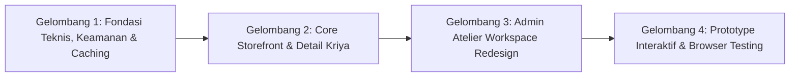

# Rencana Implementasi & Pentahapan Kerja (Implementation Plan)

**Proyek:** ZAFIRA (La Maison de Lumière — `online-shop`)  
**Metodologi:** Incremental, testable, and dependency-aware development  
**Tanggal:** 2026-10-10  

---

## 1. Strategi Pentahapan & Prioritas

Implementasi dibagi menjadi 4 gelombang prioritas berurutan:

1. **Gelombang 1 (Fondasi Teknis & Keamanan) — SELESAI:**
   - Git repository baseline.
   - Perbaikan perizinan eksekusi binary (`chmod +x`).
   - Pemasangan platform binding native Vite darwin-arm64 (`npm run build` sukses).
   - Inisialisasi database `ecommerce` lokal dan eksekusi 17 migrasi serta seeder.
   - Verifikasi 49 automated tests.
2. **Gelombang 2 (Storefront & Detail Kriya Pelanggan) — TERJAGA & TERVERIFIKASI:**
   - Mempertahankan estetika mewah, hero banner, dan dynamic category filter.
   - Halaman detail produk dengan narasi kriya, provenance, dan instruksi perawatan.
   - Tas belanja interaktif dengan sanitasi monogram dan mode concierge checkout.
3. **Gelombang 3 (Sistem Admin Atelier Modern):**
   - Transformasi dari dasbor monolitik satu halaman menjadi sistem tata kelola modular.
   - Pembuatan shared layout admin dengan sidebar atelier elegan dan header breadcrumbs.
   - Manajemen katalog produk dengan form drawer, filter pencarian, dan badge status visual.
   - Manajemen pembaruan status pesanan yang sinkron dengan halaman profil pelanggan.
4. **Gelombang 4 (Pembuatan Prototype Interaktif & Pengujian Browser):**
   - Pembuatan prototype interaktif yang dapat diakses langsung melalui browser lokal.
   - Pengujian end-to-end menggunakan browser subagent.
   - Dokumentasi panduan pengujian dan evaluasi kualitas akhir.
