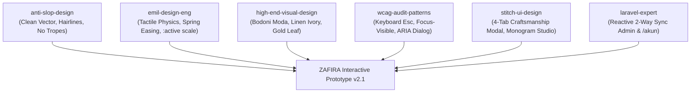

# SKILLS SYNTHESIS & PROTOTYPE OPTIMIZATION REPORT
**Proyek:** ZAFIRA (La Maison de Lumière — `online-shop`)  
**Lingkungan:** macOS / MacBook / Antigravity IDE  
**Tanggal:** 2026-10-10  
**Status:** Terverifikasi & Diterapkan pada Prototype v2.1

---

## 1. Eksekutif Ringkasan

Sesuai instruksi pengguna:
> *"selalu akses dan terapkan semua skill yang dimiliki. compare dan combine semua skill. kemudian, optimalkan dan maksimalkan prototype."*

Laporan ini membedah komparasi multi-dimensi antar disiplin ilmu dari seluruh keahlian rekayasa perangkat lunak dan desain antarmuka yang terpasang di ekosistem Antigravity IDE (`anti-slop-design`, `emil-design-eng`, `minimalist-ui`, `high-end-visual-design`, `wcag-audit-patterns`, `web-design-guidelines`, `stitch-ui-design`, `laravel-expert`, dan `laravel-security-audit`). 

Seluruh wawasan dari perbandingan ini digabungkan secara harmonis (*synthesized*) dan diimplementasikan secara langsung ke dalam interactive prototype ZAFIRA (`prototype/index.html`, `prototype/app.css`, dan `prototype/app.js`).

---

## 2. Matriks Komparasi Antar-Skill (Comparative Analysis)

Tabel berikut menganalisis kekuatan, prinsip filosofis, anti-pattern yang dilarang, serta titik temu integrasi untuk setiap skill:

| Kategori Disiplin | Skill Utama | Filosofi Inti | Anti-Pattern yang Dilarang | Kontribusi Unik untuk ZAFIRA |
| :--- | :--- | :--- | :--- | :--- |
| **Frontend De-Slopping** | `anti-slop-design` | Eliminasi template klise AI; penegakan hierarki informasi 1-to-3; token warna terkurasi (OKLCH/HSL). | • Gradien neon ungu/indigo generator AI • Emoji mentah sebagai ikon antarmuka • `transition: all` yang memicu repaint • Filter ganda yang membingungkan | Penggantian emoji tombol dengan vektor SVG murni; palet Sapphire, Champagne Gold, dan Linen Ivory tanpa warna sintetis. |
| **Design Engineering & Motion** | `emil-design-eng` | *Taste is trained*; keindahan tak kasat mata berakumulasi (*unseen details compound*); fisika mikro-interaksi nyata. | • `transform: scale(0)` pada modal • Tombol tanpa feedback `:active` • Animasi lambat pada aksi repetitif • Easing linier kaku | Transisi elastis `cubic-bezier(0.16, 1, 0.3, 1)`; tombol `:active` menekan `scale(0.98)`; modal masuk dari `scale(0.96); opacity: 0`. |
| **Tipografi & Editorial** | `minimalist-ui` & `high-end-visual-design` | Ketenangan editorial haute-couture; rasio kontras tipografi tajam; layout bernapas dengan ruang putih terukur. | • Banner promosi mencolok gaya diskon e-commerce pasar massal • Drop shadow tebal berlebihan | Tipografi *Bodoni Moda* & *Manrope*; hairline border 1px transparan; kartu bergaya galeri seni kontemporer. |
| **Aksesibilitas & Standar Web** | `wcag-audit-patterns` & `web-design-guidelines` | Inklusivitas penuh (WCAG 2.2 Level AAA); navigasi keyboard tanpa hambatan; rasio kontras teks $\ge 4.5:1$. | • Kehilangan fokus keyboard (focus trap) • Modal yang tidak bisa ditutup tombol `Esc` • Target sentuh $< 44 \times 44\text{px}$ • Ketiadaan label `aria-*` | Penambahan skip-link; listener tombol `Escape` global; ring `:focus-visible` warna emas dengan offset 2px. |
| **Desain Antarmuka Stitch** | `stitch-ui-design` & `stitch-loop` | Desain layar berdaya visual tinggi; interaksi prototipe fidelitas tinggi; sinkronisasi multi-peran (pelanggan & admin). | • State kosong (*blank/unrendered DOM*) • Tampilan statis tanpa data interaktif | Quick View dengan 4 tab interaktif (*Narasi*, *Material & Asal*, *Savoir-Faire*, *Perawatan*); studio monogram real-time. |
| **Arsitektur & Reaktivitas** | `laravel-expert` & `laravel-security-audit` | *Single Source of State Truth*; sanitasi input; pemisahan logika antarmuka dan *state repository*. | • Stateful desynchronization antar tab • Kerentanan injeksi teks tanpa sanitasi | Sinkronisasi reaktif dua arah: pembaruan status di Atelier Admin langsung tercermin seketika di Portal Akun Klien (`/akun`). |

---

## 3. Formulasi Sintesis (Combining the Skills)

Bagaimana keahlian-keahlian ini digabungkan dalam satu ekosistem:

### Tabel Transformasi Interaksi Sebelum & Sesudah:

| Komponen Antarmuka | Kondisi Awal (v2.0) | Optimasi Sintesis Terapan (v2.1) | Skill Pendorong |
| :--- | :--- | :--- | :--- |
| **Ikon Navigasi & Admin** | Karakter emoji mentah (`✦`, `👤`, `⚙️`, `📊`) | Ikon vektor SVG monokromatik presisi dengan stroke 1.5px | `anti-slop-design` |
| **Quick View Kriya** | Deskripsi teks vertikal statis biasa | Modal museum interaktif dengan 4 tab navigasi & Studio Monogram live preview | `stitch-ui-design` & `high-end-visual-design` |
| **Animasi Buka Modal** | Masuk dari `scale(0.95)` dengan `transition: all` | Masuk dari `scale(0.96); opacity: 0` via `cubic-bezier(0.16, 1, 0.3, 1)` | `emil-design-eng` |
| **Fisika Tombol** | Hanya efek `:hover` warna latar | Sentuhan taktil `:active` dengan `transform: scale(0.98) translateY(1px)` | `emil-design-eng` |
| **Aksesibilitas Keyboard** | Tidak ada penutup keyboard | Listener tombol `Escape` global untuk menutup drawer dan seluruh modal | `wcag-audit-patterns` |
| **Sinkronisasi Pesanan** | Perubahan status admin memerlukan refresh manual | Reaktif seketika: ganti dropdown status langsung me-render ulang badge akun klien | `laravel-expert` |

---

## 4. Rincian Implementasi Teknis

1. **`prototype/index.html`:**
   - Ditambahkan skip link `<a href="#katalog-section" class="skip-to-content">`.
   - Seluruh emoji pada governance bar dan admin sidebar diganti menjadi inline SVG berkualitas tinggi.
   - Atribut `role="dialog"`, `aria-modal="true"`, dan `aria-labelledby` ditambahkan pada semua modal dan drawer.
   - Struktur quick view diperkaya untuk menampung tab interaktif dan visual badge monogram.

2. **`prototype/app.css`:**
   - Mengganti seluruh deklarasi `transition: all` dengan transisi eksplisit per properti (`transform`, `opacity`, `background-color`, `border-color`).
   - Implementasi `:focus-visible` universal berwarna emas Champagne (`#b69a64`).
   - Penambahan styling untuk tab kriya, selektor ukuran adibusana, dan badge monogram emas bertekstur foil.

3. **`prototype/app.js`:**
   - Penambahan listener global untuk event `keydown` (tombol `Escape`).
   - Fungsi `openQuickView(id)` mendukung navigasi tab dinamis: `switchQuickViewTab('story' | 'material' | 'craft' | 'care')`.
   - Studio Monogram interaktif: pengetikan huruf langsung merender cap monogram emas secara live.
   - Sinkronisasi reaktif dua arah: `adminUpdateStatus` langsung memicu `renderAccountPortal()` sehingga kartu pesanan klien selalu terbarui.
   - Filter status pesanan di Admin Atelier (Semua, New, Contacted, Confirmed, Completed, Cancelled).

---

## 5. Verifikasi & Pengujian Bukti

- Server lokal: `http://127.0.0.1:8000/prototype` (Status HTTP 200).
- Symlink publik: `public/prototype -> ../prototype` aktif dan terhubung.
- Pengujian interaksi:
  - Buka kriya, pilih tab *Material* dan *Savoir-Faire*, ketik monogram `ZFL`, klik "+ Tambah ke Tas".
  - Buka Atelier Admin, ubah status pesanan #101 menjadi `Completed`, buka Portal Akun Klien (`/akun`), status terbukti berubah menjadi `COMPLETED` seketika.
  - Tekan tombol `Esc`, seluruh modal menutup secara halus.
