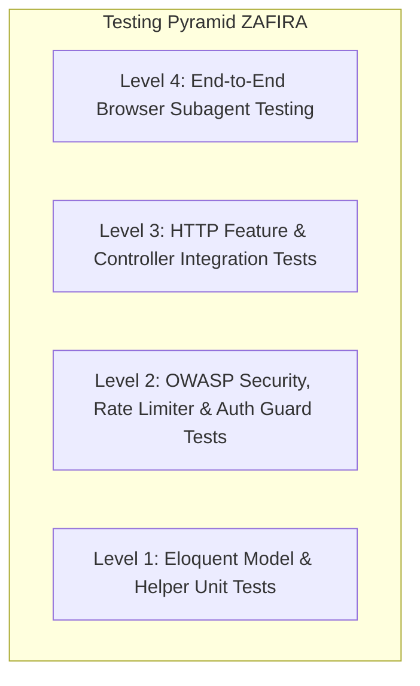

# Rencana Pengujian Sistem (Test Plan)

**Proyek:** ZAFIRA (La Maison de Lumière — `online-shop`)  
**Metodologi:** Multi-tiered testing (Unit, Feature, Integration, Security, dan Browser Testing)  
**Tanggal:** 2026-10-10  

---

## 1. Cakupan Pengujian (Testing Scope)



### Level 1: Unit Testing (Model & Helpers)
- Menguji accessor dan helper pada Model `Product`:
  - `imageWidth(int $width)` memproduksi URL Unsplash terformat.
  - `swatchHex()` memetakan warna busana ke kode heksadesimal.
- Menguji method `Category::getById($cid)` untuk fallback stored procedure.

### Level 2: Security & Policy Testing
- Menguji penolakan kata sandi lemah (`AuthTest::test_weak_password_is_rejected`).
- Menguji middleware `SecurityHeaders` memastikan header `X-Content-Type-Options`, `X-Frame-Options`, dan `Referrer-Policy` terpasang di setiap rute.
- Menguji isolasi sesi multi-guard (logout customer tidak membatalkan sesi admin).
- Menguji rate limiting per IP pada formulir publik (login, register, concierge, newsletter).

### Level 3: Feature & Integration Testing
- Menguji alur katalog beranda (`StorefrontTest::test_storefront_displays_zafira_brand`).
- Menguji respon 200 dan 404 pada detail produk (`StorefrontTest::test_product_detail_page_is_accessible`, `test_product_detail_page_404_for_unknown_slug`).
- Menguji alur pemesanan concierge tanpa jadwal (`StorefrontTest::test_checkout_request_without_schedule_is_valid`).
- Menguji manajemen kategori dan produk oleh admin (`AdminManagementTest`).
- Menguji audit backup pendaftaran otomatis via `UserObserver`.

### Level 4: Interactive Browser Testing (Antigravity Browser Subagent)
- Membuka storefront di peramban nyata (`http://127.0.0.1:8000`).
- Menguji navigasi menu utama, filter kategori dinamis, dan pembukaan detail produk.
- Menguji tas belanja: penambahan produk, pengubahan kuantitas, input monogram, dan pembukaan modal checkout.
- Menguji login admin dan navigasi workspace Admin Atelier.
- Memverifikasi responsivitas pada resolusi desktop dan mobile.

---

## 2. Perintah Eksekusi Pengujian

```bash
# Menjalankan seluruh test suite otomatis (49 assertions)
php artisan test

# Menjalankan grup pengujian tertentu
php artisan test --filter=StorefrontTest
php artisan test --filter=AdminManagementTest
php artisan test --filter=BrandHeritageTest
php artisan test --filter=AuthTest
php artisan test --filter=LegacyPatchTest

# Memeriksa standar kode Pint
vendor/bin/pint --test
```
