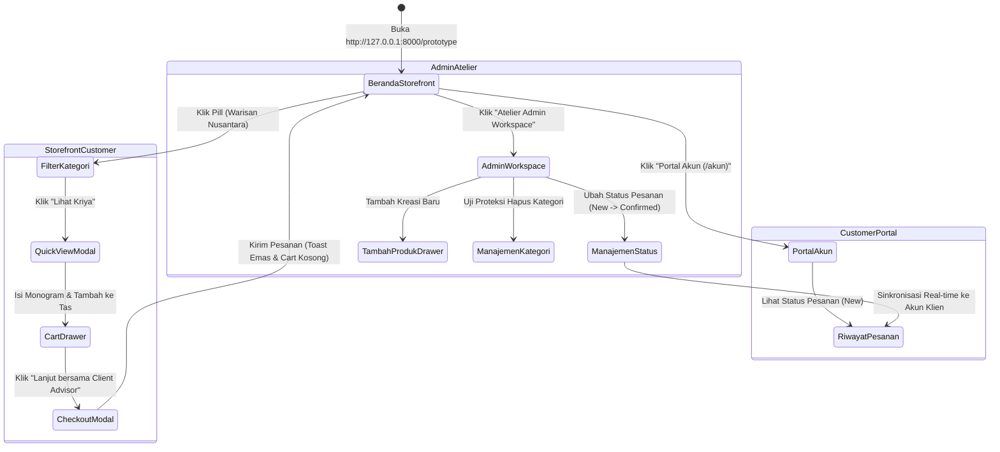

# Pemetaan Layar & Alur Interaksi Prototype (Screen & Flow Mapping)

**Proyek:** ZAFIRA (La Maison de Lumière — `online-shop`)  
**Lokasi Prototype:** `prototype/index.html` (didukung `app.css` & `app.js`)  
**Tanggal:** 2026-10-10  

---

## 1. Pemetaan Layar (Screens Mapping)

| Layar / View | Komponen Antarmuka | Target Pengguna | Keterangan & Status |
|---|---|---|---|
| **SCR-01: Storefront Beranda** | Header, Hero Banner, Announcement, Pill Filters, Product Grid, Footer | Pengunjung & Pelanggan | Fungsional interaktif penuh; tipografi Bodoni Moda & palet Safir dipertahankan |
| **SCR-02: Quick View Kriya** | Modal Split-View: Foto Resolusi Tinggi, Narasi Kriya, Provenance, Monogram Input | Pelanggan | Menampilkan cerita keahlian tangan dan asal material |
| **SCR-03: Cart Drawer** | Slide-over Panel: Daftar Item, Stepper Qty, Badge Monogram, Kalkulasi Subtotal | Pelanggan | Interaksi real-time tanpa reload; data tersimpan di state lokal |
| **SCR-04: Concierge / Checkout Modal** | Form Dialog: Nama, Email, Nomor WhatsApp, Layanan Styling, Ringkasan Pesanan | Pelanggan | Alur dual-mode: konsultasi privat atau pemesanan langsung |
| **SCR-05: Customer Portal (/akun)** | Espace Klien: Ringkasan Profil Klien, Kartu Riwayat Pesanan Real-time | Pelanggan Terdaftar | Menampilkan status pesanan yang sinkron dengan pembaruan admin |
| **SCR-06: Admin Atelier Workspace** | Sidebar Navigasi, Breadcrumbs, KPI Cards, Tabel Pesanan, Tabel Katalog, Modal Tambah Produk | Pengelola Atelier | Redesain sistematis dari dasbor monolitik lama; modular dan konsisten |

---

## 2. Pemetaan Alur Interaksi (Interaction Flow Diagram)

