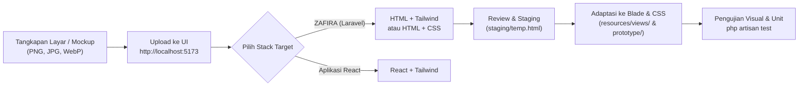

# Screenshot to Code — Local Workflow & Integration Guide

Panduan operasional dan integrasi resmi **Screenshot to Code** untuk lingkungan pengembangan **Antigravity IDE** pada macOS.

---

## 1. Metadata & Lokasi Instalasi

- **Upstream Repository:** [https://github.com/abi/screenshot-to-code](https://github.com/abi/screenshot-to-code)
- **Official Documentation:** [https://github.com/abi/screenshot-to-code/blob/main/README.md](https://github.com/abi/screenshot-to-code/blob/main/README.md)
- **Installed Git Remote:** `https://github.com/abi/screenshot-to-code.git`
- **Installed Branch:** `main`
- **Installed Commit SHA:** `a8139779f7c5ae231b7f2a86fa7f83ddc5f7badc`
- **Lokasi Isolasi (Luar Workspace):**  
  `/Users/hanifpriyambodo/Developer/tools/screenshot-to-code`
- **Arsitektur:** Terpisah penuh dari repositori aplikasi utama (`/Users/hanifpriyambodo/Documents/online-shop`).

---

## 2. Prasyarat & Versi Terverifikasi

| Komponen | Versi Terverifikasi | Path / Keterangan |
|---|---|---|
| **Sistem Operasi** | macOS 27.0.1 (Build 26A434) | Darwin arm64 |
| **Git** | 2.56.0 | Apple Git |
| **Python** | 3.12.15 | `/opt/homebrew/bin/python3.12` |
| **Poetry** | 2.5.1 | `/Users/hanifpriyambodo/.local/bin/poetry` |
| **Node.js** | v24.21.0 | `/opt/homebrew/bin/node` |
| **pnpm** | 12.10.1 | `/Users/hanifpriyambodo/.local/bin/pnpm` |
| **Playwright Chromium** | 1.61.0 | Terinstal & aktif untuk Screenshot Preview |

---

## 3. Menjalankan Layanan Lokal

### Terminal A — Backend (FastAPI + Uvicorn)
```bash
cd /Users/hanifpriyambodo/Developer/tools/screenshot-to-code/backend
poetry run uvicorn main:app --reload --port 7001
```
* **Endpoint Status:** `http://localhost:7001/` (HTTP 200)
* **Endpoint Capabilities:** `http://localhost:7001/api/capabilities` (Menampilkan `{"screenshot_preview": true}`)
* **WebSocket Codegen:** `ws://localhost:7001/generate-code`

### Terminal B — Frontend (React + Vite)
```bash
cd /Users/hanifpriyambodo/Developer/tools/screenshot-to-code/frontend
pnpm dev
```
* **URL Antarmuka:** `http://localhost:5173`
* **Vite Proxy:** Otomatis meneruskan rute `/generate-code`, `/api`, dan `/local-assets` ke `http://127.0.0.1:7001`.

---

## 4. Konfigurasi API Key (Aman & Bebas Kebocoran)

Screenshot to Code memerlukan minimal **satu provider AI** untuk menghasilkan kode.

### A. Metode Antarmuka (Direkomendasikan)
1. Buka `http://localhost:5173`.
2. Klik ikon gear (**Settings**) di pojok kiri bawah.
3. Masukkan API key pada kolom yang relevan:
   - **Gemini API key** *(Sangat direkomendasikan untuk ekstraksi aset nyata & video mode)*.
   - **Anthropic API key** *(Claude Opus 4.8 / 5.5, Sonnet)*.
   - **OpenAI API key** *(GPT-5.5, GPT-6.1 Sol)*.
   - **Replicate API key** *(Untuk image generation & background removal)*.
4. Kunci tersimpan di `localStorage` peramban Anda, tidak dikirim ke repositori git atau server pihak ketiga mana pun.

### B. Metode Backend `.env` (Alternatif)
Jika ingin mengonfigurasi di level server lokal backend:
```bash
cd /Users/hanifpriyambodo/Developer/tools/screenshot-to-code/backend
touch .env
chmod 600 .env
```
Isi variabel yang dibutuhkan (pastikan tidak membagikan atau meng-commit file ini):
```bash
# GEMINI_API_KEY=...
# ANTHROPIC_API_KEY=...
# OPENAI_API_KEY=...
# REPLICATE_API_KEY=...
```

> [!WARNING]
> **Biaya Penggunaan Model AI:** Setiap permintaan generasi kode ke OpenAI, Anthropic, Gemini, atau Replicate menggunakan kuota akun API pribadi Anda dan dapat menimbulkan biaya dari penyedia terkait. Gunakan secara bijak dan hindari generasi berulang tanpa keperluan visual nyata.

---

## 5. Alur Kerja: Screenshot ke Kode & Integrasi ke ZAFIRA



### Langkah demi Langkah:
1. **Persiapkan Referensi Visual:**
   - Gunakan tangkapan layar bersih komponen UI (desktop 1440px atau mobile 390px).
   - Hindari data sensitif atau informasi pribadi pada gambar.
2. **Unggah ke Antarmuka:**
   - Tarik & lepas gambar ke area dropzone pada `http://localhost:5173`.
3. **Pilih Stack:**
   - Untuk proyek ZAFIRA (Laravel + Blade), pilih **HTML + Tailwind** atau **HTML + CSS**.
4. **Ekspor & Staging:**
   - Salin kode hasil generasi ke file staging sementara (misal `storage/framework/staging_code.html` atau scratchpad).
5. **Adaptasi ke Arsitektur Proyek:**
   - Pisahkan struktur tata letak ke komponen Blade (`resources/views/components/` atau `resources/views/layouts/`).
   - Pertahankan variabel dinamis server-side (`{{ $product->name }}`, `@auth`, `@csrf`).
   - Terapkan design tokens ZAFIRA: tipografi *Bodoni Moda* & *Manrope*, serta palet *Sapphire, Linen, Gold, Ivory*.
   - Jangan pernah mengganti seluruh aplikasi Laravel dengan halaman HTML statis!
6. **Verifikasi & Regresi:**
   - Jalankan `php artisan test` untuk memastikan logika bisnis, otentikasi, dan rute tidak terganggu.
   - Uji tampilan pada viewport desktop (1440px) dan mobile (390px).

---

## 6. Panduan Pemecahan Masalah (Troubleshooting)

1. **Port 7001 atau 5173 Terpakai:**
   - Periksa proses: `lsof -i :7001` atau `lsof -i :5173`.
   - Pastikan backend dan frontend dijalankan pada port yang sinkron. Jika port backend diganti, sesuaikan `PROXY_CODEGEN_BACKEND` pada `frontend/vite.config.ts`.
2. **Status "Screenshot Preview" Tidak Aktif (Silang Abu-Abu):**
   - Jalankan instalasi Chromium Playwright di backend:
     ```bash
     cd /Users/hanifpriyambodo/Developer/tools/screenshot-to-code/backend
     poetry run playwright install chromium
     ```
   - Restart backend uvicorn.
3. **Koneksi WebSocket Gagal Saat Generate:**
   - Pastikan backend uvicorn berjalan aktif di port 7001.
   - Pastikan API key penyedia model telah diisi dengan benar di modal **Settings**.
