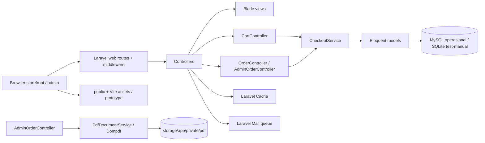
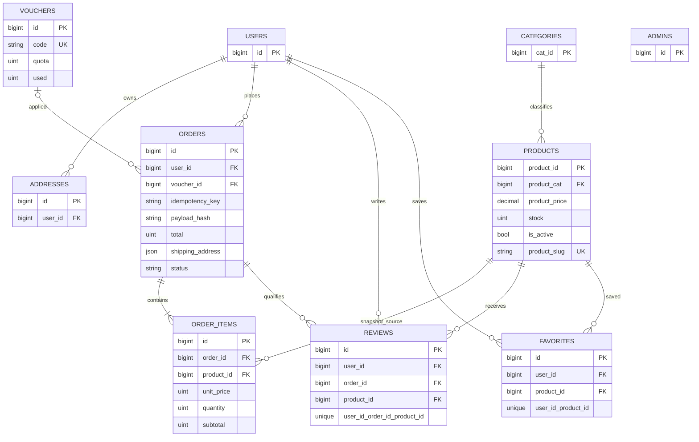

# ZAFIRA — Arsitektur As-Is

Tanggal audit: 14 Oktober 2026, snapshot awal 08:33:47 WIB. Repo: `/Users/hanifpriyambodo/Documents/online-shop`.

## Ringkasan berbasis bukti

Aplikasi adalah monolit Laravel 12 dengan storefront Blade, JSON endpoints untuk katalog/keranjang/pesanan/admin, Eloquent, dan satu service checkout. Frontend memakai Vite/Tailwind 4. Konfigurasi `.env` saat dibaca via allowlist menyebut driver MySQL; target sebenarnya tidak dihubungi dan tetap UNKNOWN; profil uji manual terpisah menggunakan SQLite. Aplikasi dan profil manual sudah memiliki bukti alur browser historis, tetapi bukti itu bukan eksekusi audit baru dan bukan kesiapan produksi.

**Produk yang dinyatakan sumber:** laman rumah mode bernama ZAFIRA; deskripsi JSON-LD menyebut Paris–Italia–Indonesia, batik tulis, songket, dan tenun Nusantara (`app/Http/Controllers/StorefrontController.php:53-61`). Ini fakta copy produk, bukan bukti pasar, positioning komersial tervalidasi, persona, atau klaim kualitas produk. Persona premium dalam AGENTS.md adalah arahan desain, bukan hasil riset pelanggan.

**Batas produk teramati:** katalog aktif, detail produk, keranjang sesi server, checkout menghasilkan order `pending`, manajemen alamat, ulasan/favorit, reservasi concierge, newsletter, admin status pesanan, invoice HTML, PDF laporan admin. Tidak ditemukan payment gateway/penyelesaian pembayaran dalam rute atau service yang diperiksa. Ukuran/warna/monogram masuk pada jalur concierge, bukan item/order checkout.

## Stack aktual dan status kepastian

| Lapisan | Dideklarasikan/dikunci | Terpasang/terlihat runtime | Catatan |
|---|---|---|---|
| Backend | PHP `^8.2`; `laravel/framework ^12.0`; Dompdf `3.1.6` persis (`composer.json:5-9`) | PHP 8.5.11 dan Composer 2.10.3 pada snapshot lingkungan | Versi runtime dicatat, bukan verifikasi build baru. |
| Frontend | Node ESM; Vite `^8.2.2`, Tailwind `^4.0.0`, Laravel Vite plugin `^3.2.0` (`package.json`) | Node 24.21.0, npm 11.19.0; `node_modules/` ada | Belum menjalankan build audit ini. |
| DB | Laravel koneksi default SQLite jika env tak ada; .env operasional historis MySQL; `.env.manual` SQLite file | Baca langsung SQLite manual saat audit: 24 migration tercatat, 0 produk, 0 kategori, 0 order; bukti 12 produk dan satu cancelled order hanya historis | Tidak ada klaim data manual masih sama; jangan bootstrap default; tujuh migration pending hanya dilaporkan historis pada MySQL. |
| Session/cache/queue/mail | Test XML menggunakan array/array/sync/array; manual memakai database/database/database/log (VERIFIKASI.md) | Belum dibootstrap ulang; kolektor membaca allowlist key/value aman `.env.manual`, tanpa mencatat rahasia | Manual persistent SQLite bukan data produksi, namun bootstrap memerlukan isolasi terjamin. |
| Browser/UI | Blade + Vite, public prototype aset statis | Artefak screenshot/browser terdahulu tersedia | Koordinator melaporkan dua GET ke server aktif 8016 sebelum bukti isolasi selesai; lihat insiden di TEST_RESULTS.md. Run isolasi lanjutan: lifecycle, PDF, viewport dan keyboard PASS terbatas; WCAG penuh NOT RUN (`evidence/runtime-20261014/RUNTIME_REPORT.md`). |
| PDF | Dompdf 3.1.6; layanan menghasilkan byte PDF | Bukti lama melaporkan ekstraksi teks CJK dan preview berhasil | Bukan uji baru. |

Installed exact versions perlu dibaca dari lock/installed metadata, tidak disimpulkan dari range manifest. Closure Dompdf lima paket terjaga dalam hasil historis `commonmark-upgrade`; jangan ubah dependency.

## Diagram komponen

## ERD (migrations)

Sumber ERD: migration produk/kategori, user/admin, orders/items, address, voucher, reviews, favorites. Relasi admin independen dari user. `order_items` menyimpan snapshot judul/harga, tapi FK produk tetap restrict delete; penghapusan produk berorder dapat ditolak.

## Jejak 5 alur

### 1. Katalog → detail PDP
`GET /koleksi` → `CatalogController::index` (filter locale, q, category, color, material; hanya produk aktif; pagination 8) → view `catalog.index`; `GET /produk/{product:product_slug}` → `StorefrontController::show` → cache produk/related 300 detik → `products.show`. Sumber: `routes/web.php:28-33`; `CatalogController.php:13-64`; `StorefrontController.php:65-110`. Katalog tidak mengungkap stok pada query storefront di metode ini. PDP JSON-LD menyatakan availability InStock tetap, tidak bergantung stok aktual: potensi ketidakcocokan representasi; perlu verifikasi HTML browser saat perubahan data.

### 2. Keranjang → harga
POST `/cart/items` menyimpan `product_id => quantity` pada session; validasi quantity 1..99, produk aktif/stock awal; harga tidak dipercayai dari klien. `CheckoutService::priced` baca ulang harga DB dan hitung subtotal integer. DELETE item menghapus langsung, tidak ada undo server-side. Sumber: `routes/web.php:41-44`; `CartController.php:17-49`; `CheckoutService.php:19-74`. Keranjang set kuantitas, bukan increment.

### 3. Checkout → stok
POST `/checkout` auth + throttle 10/menit; alamat harus milik user; idempotency key wajib; service menghitung payload hash, mengunci row user, validasi harga/stok ulang, conditional decrement stok, klaim voucher, lalu menyimpan order dan item dalam transaksi. Order pending; controller mengosongkan keranjang hanya saat order baru. Sumber: `routes/web.php:62-74`; `OrderController.php:35-60`; `CheckoutService.php:76-197`. Bukti historis MySQL/MariaDB punya ERROR 1558 schema mismatch dan concurrency belum dibuktikan; SQLite fixture historis tidak membuktikan semantik engine produksi.

### 4. Pembatalan berulang
User cancellation scoped `user_id`, cek can-cancel termasuk cancelled idempotently; transition melakukan compare-and-set status lama → baru di transaksi, lalu mengembalikan stok dan voucher hanya ketika update satu row sukses. Status cancelled berulang diperlakukan no-op sebelum transaksi. Sumber `OrderController.php:62-73`, `Order.php:11-59`, `CheckoutService.php:200-228`. Hipotesis risiko bersaing transisi status: model passed-in bisa stale, update CAS menolak jika state sudah berubah. Dua pembatalan simultan berpotensi satu gagal 409, bukan double-restock. Belum diverifikasi dengan proses independen/engine produksi.

### 5. Admin → PDF
Auth `admin`; GET `/admin/reports/orders.pdf` validasi rentang (`today|7d|30d|custom`), UTC, maksimal 366 hari/500 pesanan, hasil membedakan non-cancelled order value dari paid revenue; render `PdfDocumentService::render(string $title,array $lines):string`, Dompdf remote/PHP/JS disabled, chroot terbatas font/cache, escape HTML, output attachment private no-store. Sumber `routes/web.php:90-106`; `AdminOrderController.php:53-117`; `PdfDocumentService.php:15-127`. Pembatasan role terverifikasi secara struktur rute; akses report/browser audit kali ini tidak dijalankan.

## Data, integritas, security, performance

- Nilai produk sumber `DECIMAL(10,2)`; checkout menolak pecahan non-zero dan mem-parsing rupiah integer (regex maksimal 12 digit) (`CheckoutService.php:67-74`). Order/line memakai unsigned bigint rupiah; tidak ada constraint DB eksplisit `total = subtotal - discount + shipping` atau `subtotal = sum(lines)`.
- Unique `(user_id,idempotency_key)`, payload SHA-256 membatasi reuse key ke payload konsisten; concurrency recovery menangkap QueryException dan replay. Scope user mencegah cross-user collision. Cart session saja tidak persistence lintas device.
- Stok `unsignedInteger`; decrement conditional guarded, transaksi atomic. `lockForUpdate()` pada user tidak menjamin locking row di SQLite; concurrency claim di MariaDB/MySQL belum tervalidasi.
- Ownership: order list/show/cancel scoping user; address lookup juga scoped. Admin routes protected by `auth:admin`. Review ownership dan status order perlu audit lebih lanjut sebelum jadi jaminan.
- Ancaman: credential/session theft, CSRF (web middleware bawaan perlu runtime verify), abusive auth/concierge/newsletter (IP throttles terdefinisi), oversell/race engine, cross-account IDOR (scoping terlihat), malicious HTML/XSS (Blade escaping; invoice e() explicit), PDF SSRF/file access (remote off, file protocol + chroot), data exposure in logs/PII, dependency supply chain. CSP hanya Report-Only (`SecurityHeaders.php:21-25`) dan mengizinkan inline styles; bukan enforcement.
- Targeted perf: storefront cache 5 menit/select columns/eager category; related products query; catalog filters use lower-like scans and distinct color/material; add indices after EXPLAIN representative dataset, not speculative. Order listing eager-loads items/users and pagination; PDF caps 500. Cache invalidation admin path must be tested across product/category changes.

## Benchmark eksternal

Snapshot baru memakai tepat 10 nama yang diminta: Amazon, Alibaba/Tmall, JD.com, PDD/Temu, Walmart, eBay, MercadoLibre, Sea/Shopee, Rakuten, Coupang.

**Koreksi relevansi 2026-10-14 (remediasi).** Pembacaan manual cuplikan tersimpan mengubah hitungan dari 6 OBSERVED/4 UNKNOWN menjadi **4 OBSERVED/6 UNKNOWN**:

- **Walmart → UNKNOWN.** URL primer membalas HTTP 200 tetapi isinya soft-404 (“This page no longer exists”); laman korporat cadangan hanya menyebut nama kebijakan. Tidak ada teks kebijakan retur yang teramati.
- **Coupang → UNKNOWN.** Primer diblokir 403; cadangan adalah laman korporat/investor, bukan kebijakan retur.
- **Rakuten → OBSERVED dengan cakupan terbatas.** Teks yang teramati hanya mengarahkan pertanyaan pesanan, pembatalan, dan retur ke masing-masing toko. Itu pengalihan kontak, bukan syarat kebijakan retur.

HTTP 200 sendiri bukan bukti fitur, kebijakan, atau mutu. Skor komparatif tetap NOT RUN. Detail URL, upaya, teks, status relevansi per retailer, dan keterbatasan ada di `evidence/public-benchmarks.json`.

## Pilihan remediasi

A. **Minimum:** jangan rewrite. Buktikan isolasi sink, rehearsal migration MySQL/MariaDB terisolasi, uji concurrency lintas proses, kejelasan status pembayaran dan ongkir berdasarkan kebijakan yang diputuskan, keamanan proporsional, lalu kumpulkan bukti browser/WCAG; hanya perbaikan yang dibuktikan.
B. **Modularisasi targeted:** pisahkan contract checkout/payment/inventory dan layer presentation API vs HTML hanya bila kebutuhan tumbuh dan tests kontrak tersedia; isolasi persistence/cache/mail interfaces tanpa mengganti monolit framework.
C. **Rewrite:** belum justified. Bukti tidak menunjukkan monolit tak dapat memenuhi correctness, operasi, atau roadmap; rewrite menambah risiko data/migrasi dan membuang behavior teruji.

## Pemeriksaan statis UI (bukan lulus browser/WCAG)

- Blade storefront `resources/views/welcome.blade.php:557-565` menyediakan dialog keranjang dan kontrol Undo. `resources/views/catalog/index.blade.php:536,591-616` memiliki `<dialog>` dan jalur fokus; sumber tidak membuktikan interaksi pada perangkat.
- `resources/js/app.js:68-84,176-210,795-832` menetapkan `inert`, `aria-hidden`, fokus, penanganan Escape dan pembatasan Tab. `app.js:1-9` membaca reduced-motion untuk scroll. Hasil runtime termasuk trap fokus, screen reader, dan Escape tetap NOT RUN.
- `resources/css/app.css:932-968` memperluas sebagian area target menjadi 44px, namun beberapa kontrol compact 24px dan klaim spacing exception dalam komentar belum diverifikasi geometri browser. Kontras/reflow/zoom tetap UNKNOWN.
- `resources/views/shop/index.blade.php:126-139` memperlihatkan guard alamat/stok, idempotency key, konfirmasi hapus, dan pesan `pending / belum dibayar`. JS lokal keranjang storefront berbeda dari keranjang server; perilaku lintas alur perlu uji.
- Cuplikan literal bernomor ada pada lampiran `SOURCE_EXCERPTS.md`. Penilaian heuristik tujuh tokoh HCI pada AGENTS.md bersifat pemeriksaan pola statis, bukan usability study.

## Batas insiden dan status keseluruhan

Koordinator melaporkan GET `/koleksi` dan `/` pada server 8016 berstatus 200 sekitar 08:48 WIB, sebelum pembuktian sink lengkap. Snapshot SQLite manual read-only pertama memuat 24 migration, 0 products/orders/users, 2 sessions; pembacaan lain setelah itu menemukan 6 sessions dan mtime berubah. Kausalitas, waktu spesifik perubahan dan kaitannya dengan kedua GET tersebut **UNKNOWN**. Jangan mengklaim tidak ada HTTP secara global atau browser PASS. Server tidak dihentikan. Audit statis tercapai, asesmen penuh **INCOMPLETE**; runtime, browser, concurrency, migrasi target dan uji otomatis tetap NOT RUN.
